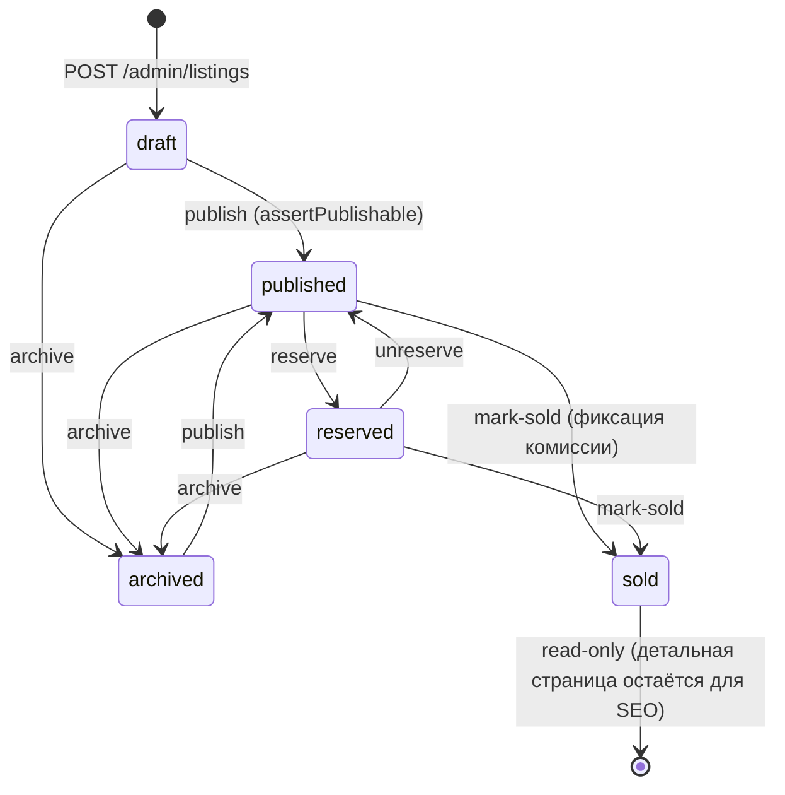
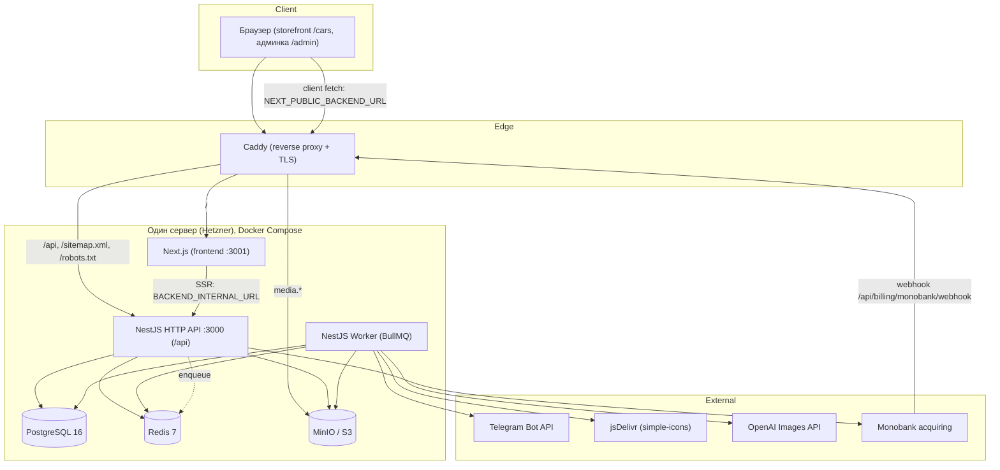

# AutoFlow — Agent Context (канонический контекст продукта)

> Единый самодостаточный документ для нового AI-агента. Прочитав только этот
> файл, агент должен понять систему целиком: назначение, бизнес-флоу, архитектуру,
> модули, API, модели данных, роли, frontend, конфигурацию, тесты и техдолг.

---

## Метаданные анализа

| Поле | Значение |
|------|----------|
| Продукт | **AutoFlow** — курируемая витрина объявлений о продаже авто для одного автосалона (single-tenant) |
| Дата анализа | **2026-08-17**, обновлено **2026-10-16** |
| Проанализированный commit | `5428929` (ветка `feat/hosting-billing`; базовый анализ — `abe0830` на `main`) |
| Заголовок коммита | `feat(photo-ai): managed AI mode with prepaid photo packs` |
| Что добавлено при обновлении | Мини-CRM лидов, история цен, сравнение, коллекции в БД, теги, аналитика (конверсия/атрибуция), админка каталога, фото-ШИ (own_key / managed + пакеты фото), биллинг хостинга через Monobank, массовые действия, ретрай медиа. Сведения сверены с кодом по отчётам read-only агентов; приложение для этого обновления не запускалось. |
| Версия backend | `1.0.0` (package.json, `name: autoflow-backend`) |
| Корень репозитория | `/Users/andreypavlenko/Desktop/Projects/AutoFlow` |
| Границы исследования | Прочитаны: backend (`src/`), frontend (`frontend/src/`), миграции, сиды, docker/deploy, CI/CD, тесты, конфиги. НЕ выполнялись: запуск приложения, чтение содержимого `node_modules`, архива `AutoFlow каталог авто.zip`, реальных значений `.env` (только `.env.example`). Значения enum/полей выверены по entity-файлам и миграциям. |
| Язык интерфейса | Украинский (единственная локаль; `frontend/messages/uk.json`) |

**Легенда достоверности** (используется в разделах ниже):

- ✅ **Подтверждено** — прочитано в коде/миграции/конфиге (указан путь).
- 🔷 **Окружение** — обнаружено в текущем dev-окружении/сидах.
- 🟡 **Предположение** — логичный вывод, не подтверждён напрямую.
- ❓ **UNKNOWN** — недостаточно данных, требуется проверка.

---

## Оглавление

1. [Quick Context](#quick-context)
2. [1. Общее описание продукта](#1-общее-описание-продукта)
3. [2. Основные бизнес-флоу](#2-основные-бизнес-флоу)
4. [3. Функциональные возможности](#3-функциональные-возможности)
5. [4. Архитектура системы](#4-архитектура-системы)
6. [5. Модули и структура кода](#5-модули-и-структура-кода)
7. [6. API и интеграции](#6-api-и-интеграции)
8. [7. Бизнес-модели и модели данных](#7-бизнес-модели-и-модели-данных)
9. [8. Пользователи, роли и права](#8-пользователи-роли-и-права)
10. [9. Frontend и пользовательский интерфейс](#9-frontend-и-пользовательский-интерфейс)
11. [10. Конфигурация и окружение](#10-конфигурация-и-окружение)
12. [11. Тестирование и качество](#11-тестирование-и-качество)
13. [12. Ошибки, ограничения и технический долг](#12-ошибки-ограничения-и-технический-долг)
14. [13. Глоссарий](#13-глоссарий)
15. [14. Карта связей](#14-карта-связей)
16. [15. Статус достоверности](#15-статус-достоверности)
17. [Instructions for a New Agent](#instructions-for-a-new-agent)

---

## Quick Context

**Что это.** AutoFlow — витрина подержанных/новых авто для одного автосалона. Публичная
часть (storefront) доступна без авторизации и показывает опубликованные объявления.
Заводит и ведёт объявления только персонал салона через админку. Поддерживается
консигнация (продажа авто клиентов с комиссией), мультивалютность, автопубликация
объявлений в Telegram-каналы, лиды (заявки) с мини-CRM, отзывы, аналитика, теги и
SEO-коллекции, сравнение авто, ИИ-обработка фото (OpenAI), а также оплата хостинга
платформы и пакетов фото через Monobank (биллинг выключен по умолчанию).

**Стек.**
- **Backend:** NestJS 11 (TypeScript), модульный монолит. Два процесса из одного образа:
  HTTP API (`src/main.ts`) и BullMQ-воркер (`src/worker.ts`).
- **БД:** PostgreSQL 16, TypeORM 0.3, миграции (не `synchronize`). Роль-разделение:
  миграции/сиды под owner-ролью, рантайм — под low-privilege `app_user`.
- **Очереди/кеш:** Redis 7 + BullMQ 5 (очереди `notifications`, `media`, `views`,
  `maintenance`, `telegram`, `photo-ai`).
- **Внешние API:** Telegram Bot API, OpenAI Images (`images/edits`), Monobank acquiring.
- **Хранилище:** S3-совместимое (MinIO в dev), `@aws-sdk/client-s3`, presigned upload,
  обработка изображений через `sharp` (vips).
- **Frontend:** Next.js 15 (App Router, React 19 RC), Tailwind, next-intl (uk),
  TanStack Query, zod. Отдельное приложение в `frontend/`, порт 3001.
- **Деплой:** один сервер (Hetzner), Docker Compose + Caddy (reverse proxy, TLS).
  CI/CD — GitHub Actions → Docker Hub → SSH-деплой.

**Ключевые факты для быстрой ориентировки.**
- Публичный API префикс: **`/api`** (глобальный prefix из `API_PREFIX`, `src/main.ts:20`).
  Например, публичный листинг: `GET /api/listings`, деталь: `GET /api/listings/:slug`.
- Публичные URL storefront используют **`/cars`**, а API — **`/listings`**. Это разные
  пространства: canonical и ссылки ведут на `/cars/[slug]`, данные берутся из `/api/listings/:slug`.
- Роли ровно две: **`admin`** (полный доступ) и **`editor`** (объявления, лиды, страница
  каталога без удаления, фото-ШИ по политике доступа; цены/баланс/даты оплаты не видит).
- Глобальные guards: `JwtAuthGuard → RolesGuard → BillingGuard → ThrottlerGuard`. При
  заблокированной оплате хостинга все авторизованные роуты отвечают **402**, кроме
  `@AllowWhenBillingBlocked` (`/admin/billing/*`, `GET /auth/me`); публичный сайт работает.
- Все сущности — **soft delete** (`deleted_at`), уникальность — через partial unique index
  `WHERE deleted_at IS NULL`. Оптимистичная блокировка — колонка `version`.
- Цена хранится в исходной валюте (`price_amount`+`price_currency`) и нормализованной
  (`price_normalized`) в базовой валюте сайта. Фильтр/сортировка по цене — только по
  нормализованной. Курсы v1 — статические из env (`FX_STATIC_*`).
- Swagger: `GET /api/docs`.
- Демо-логины (dev/seed): `admin@autoflow.example` / `Demo!Password12345` (admin),
  `editor@autoflow.example` / `Demo!Password12345` (editor, только dev).

**Не реализовано в v1:** логика `reservations` (только сущность+миграция; статус
`listing='reserved'` ставится вручную и не связан с таблицей `reservations`); импорт
фидов/парсинг (`source_type='feed'|'parser'` — только заглушка типа); оплата покупателями
(депозиты/брони). Telegram-уведомления менеджеров о заявках реализованы (`TelegramLeadChannel`,
email-канала нет), как и публикация объявлений в каналы. Оплата **хостинга платформы** и
**пакетов фото** клиентом-салоном через Monobank реализована (см. 2.9, 2.11).

---

## 1. Общее описание продукта

### 1.1 Назначение

AutoFlow — программная витрина (каталог) автомобилей на продажу для **одного бизнеса**
(автосалона). Продукт закрывает две задачи:

1. **Публичная витрина (storefront)** — SEO-оптимизированный сайт, где покупатели ищут
   авто по фильтрам, смотрят детальные карточки с галереей и характеристиками, оставляют
   заявки (callback, сообщение, тест-драйв, «продай своё авто», кредит).
2. **Админка (back-office)** — персонал салона заводит объявления, загружает фото, управляет
   статусами (черновик → публикация → продано), обрабатывает лиды (мини-CRM), ведёт справочник
   и теги, SEO-коллекции, настраивает брендинг, отзывы, команду, смотрит аналитику, публикует
   объявления в Telegram, обрабатывает фото с помощью ИИ и оплачивает хостинг платформы.

Источник: `README.md:1-5`, `package.json` (`description: "AutoFlow — curated car listings backend (modular monolith)"`).

### 1.2 Какую проблему решает

- Салону нужен собственный брендированный сайт-каталог без зависимости от маркетплейсов.
- Нужен единый процесс: приём авто (в т.ч. чужих — консигнация) → карточка → медиа →
  публикация → лиды → продажа с фиксацией комиссии → аналитика.
- Нужна автоматическая дистрибуция объявлений в Telegram-каналы.
- Нужна мультивалютность (USD/UAH/EUR) с корректной сортировкой по цене.
- Нужна быстрая подготовка фото без ретушёра (ИИ-обработка: свет/баланс белого или замена фона).
- Платформа продаётся салонам с хостингом на серверах вендора: ежемесячная оплата хостинга
  и докупка пакетов ИИ-фото прямо из админки (Monobank).

### 1.3 Основные пользователи и роли

| Тип | Кто | Доступ |
|-----|-----|--------|
| **Публичный посетитель** | Покупатель, аноним | Только storefront: просмотр опубликованных объявлений, отправка заявок. Без авторизации. |
| **editor** | Контент-менеджер салона | Админка: объявления (CRUD без удаления, статусы, массовые publish/archive, медиа и ретрай, Telegram-пост, выбор тегов), лиды (список, статус, ответственный, follow-up, заметки), страница `/admin/catalog` (создание/правка make/model, логотипы; без удаления), добавление цвета по названию, фото-ШИ — если разрешено политикой доступа. При блокировке оплаты видит только экран «не оплачено». НЕ видит команду, брендинг, отзывы, audit, аналитику, теги/коллекции (CRUD), оплату, цены и баланс фото. |
| **admin** | Владелец/администратор салона | Полный доступ: всё выше + удаление (объявления, make/model, теги, коллекции), брендинг (включая Telegram-токен), настройки фото-ШИ и пакеты фото, оплата хостинга, команда (admin-users), отзывы, коллекции, теги, audit log, аналитика, весь справочник. |

Источник: `README.md:30-34`, `src/app.module.ts` (guards), `src/modules/auth/roles.guard.ts`, контроллеры с `@Roles(...)`.

### 1.4 Ключевые бизнес-объекты

- **Listing** (объявление/авто) — ядро системы. Статусы: `draft → published → reserved →
  sold → archived`.
- **ListingMedia / MediaRendition** — фото/видео объявления и их обработанные версии.
- **Lead** (заявка) — обращение покупателя. Типы: `callback | message | test_drive |
  sell_request | credit`.
- **SiteSettings** (branding) — singleton с настройками сайта (лого, цвета, контакты, SEO,
  базовая валюта, Telegram-конфиг).
- **Catalog** — справочники: makes, models, body types, fuel types, transmissions, drive
  types, colors, vehicle options.
- **AdminUser** — учётка сотрудника (admin/editor).
- **Review** — отзыв клиента (для главной страницы).
- **AuditLog** — неизменяемый журнал действий.
- **ListingTelegramPost** — факт публикации объявления в конкретный Telegram-канал.
- **Reservation** — сущность бронирования (в v1 не используется логикой).
- **LeadNote** — неизменяемая заметка к лиду; у Lead появились `assignee_id`, `follow_up_at`.
- **ListingPriceHistory** — append-only история цены; у Listing — `previous_price_normalized`,
  `price_changed_at` (бейдж «цена снижена»).
- **Collection** — SEO-подборка в БД (key, title, query-фильтры, публикация, порядок).
- **Tag / ListingTag** — курируемые ярлыки объявлений (`catalog_tags`, `listing_tags`).
- **PhotoAiSettings / PhotoAiGeneration / PhotoAiPreset** — настройки, задачи и пресеты ИИ-фото;
  у ListingMedia — `active_ai_variant`, `ai_revision`.
- **PhotoAiBalance / PhotoAiLedgerEntry** — баланс пакетов фото (managed) и append-only журнал.
- **BillingAccount** — singleton с `paid_until` хостинга; **BillingInvoice** — инвойсы Monobank
  (`kind = hosting | photo_pack`).

### 1.5 Границы системы (что входит / что снаружи)

**Входит в платформу:**
- Backend API (NestJS), фоновый воркер, PostgreSQL, Redis, S3-хранилище, Next.js storefront+админка,
  Caddy-прокси. Всё разворачивается на одном сервере через Docker Compose.

**Снаружи (внешние зависимости):**
- **Telegram Bot API** (`https://api.telegram.org`) — публикация объявлений в каналы.
- **simple-icons через jsDelivr CDN** (`https://cdn.jsdelivr.net/npm/simple-icons`) — логотипы
  марок авто.
- **Wikimedia Commons** — источник фото для демо-сидов (только dev, `seed-demo-cars.ts`).
- **FX-курсы** — в v1 статические из env; внешний провайдер не подключён.
- **Let's Encrypt** — TLS-сертификаты через Caddy (в domain-режиме).
- **OpenAI Images API** (`https://api.openai.com/v1/images/edits`) — ИИ-обработка фото
  (`src/modules/photo-ai/photo-ai.provider.ts`).
- **Monobank acquiring** (`https://api.monobank.ua`) — оплата хостинга и пакетов фото, входящий
  webhook `/api/billing/monobank/webhook` (`src/modules/billing/monobank.client.ts`).

**Не является частью продукта:** оплаты покупателей (депозиты/брони — `reservations` не
реализованы), полноценная CRM (есть только мини-CRM лидов), импорт объявлений из внешних фидов,
мобильные приложения.

---

## 2. Основные бизнес-флоу

Обозначения: 🎬 инициатор · 👥 участники · ⚙️ сервисы/очереди · 💥 побочные эффекты.

### 2.1 Flow: Создание и публикация объявления (end-to-end)

**Цель:** завести авто в каталог и вывести его в публичную витрину.
🎬 editor/admin · 👥 backend listings/media/telegram/fx, S3, воркер, Telegram.

**Предусловия:** пользователь авторизован (Bearer access-token), существуют справочники
(make/model/body/fuel/transmission/drive/color).

**Шаги:**

1. **Создание черновика.** `POST /api/admin/listings` с `CreateListingDto`.
   `ListingsService.create()` (`src/modules/listings/listings.service.ts`):
   - Валидирует консистентность консигнации (`assertConsignmentConsistent`) и каталожные
     ссылки (`assertCatalogRefs`: `model.makeId` должен совпадать с `makeId`).
   - Строит slug: `make.slug-model.slug-year` + при коллизии `nanoid(6)` (`SlugService.unique`).
   - Считает нормализованную цену: `FxRateProvider.convert(price_amount, price_currency,
     defaultCurrency)` → `price_normalized`, `fx_rate`, `fx_rate_at`.
   - Сохраняет со `status='draft'`, `source_type='manual'`. Если переданы `optionIds` —
     пишет строки `listing_options` в транзакции; `tagIds` — строки `listing_tags`.
   - Пишет первую строку `listing_price_history` (базовая цена, см. 2.13).
   - 💥 Audit: `listing.create`.
2. **Загрузка медиа** (см. flow 2.2). Нужно ≥1 фото со статусом `ready`.
3. **Публикация.** `POST /api/admin/listings/:id/publish` с `{ version, ... }`.
   `ListingsService.transition('publish', ...)`:
   - Проверка `version` (иначе 409), допустимость перехода (`draft|archived|reserved →
     published`, иначе 403).
   - `assertPublishable()` (иначе **422** со списком причин): есть ≥1 `image` со `status='ready'`;
     если `vin_visible=true` — задан `vin`; консигнация консистентна.
   - Первую публикацию помечает `published_at = now()` (повторная публикация из archived/reserved
     `published_at` не перезаписывает).
   - 💥 Audit: `listing.publish`. 💥 Если это **первая** публикация — `telegram.enqueueAutoPost(id)`
     (очередь `telegram`); ошибки проглатываются (best-effort).
4. **Telegram-автопост** (если в брендинге `telegram.autoPublish=true` и настроены каналы) —
   см. flow 2.4.

**Изменения состояния:** `listings.status: draft→published`, `published_at` заполнено.
**Ошибки:** 409 (version), 403 (недопустимый переход), 422 (не готово к публикации), 404 (нет объявления).
**Успех:** объявление видно на `/api/listings` и `/cars/[slug]`.



### 2.2 Flow: Загрузка и обработка медиа

**Цель:** привязать фото/видео к объявлению и сгенерировать оптимизированные рендишены.
🎬 editor/admin · 👥 media-сервис, S3, воркер `media`.
Источник: `README.md:109-121`, `src/modules/media/media.service.ts`, `src/workers/media-processor.worker.ts`.

1. `POST /api/admin/listings/:listingId/media` с `CreateMediaDto` (`type`, `contentType`,
   `filename`, `sizeBytes`). Сервис валидирует размер (`MEDIA_MAX_BYTES`), генерирует ключ
   `listings/{listingId}/original/{nanoid(16)}.{ext}`, создаёт `ListingMedia(status='pending')`
   и возвращает **presigned PUT URL**.
2. Клиент **PUT-ит файл напрямую в S3** по presigned URL.
3. `POST /api/admin/media/:id/confirm`. Сервис делает `HEAD` в S3 (проверка наличия/размера),
   сверяет MIME. Для **изображений**: `status='processing'` (до постановки в очередь, чтобы
   sweep не удалил), enqueue job `process` (jobId `media-{id}`, 3 попытки, backoff 5s).
   Для **видео**: проверяет magic-байты `ftyp`, сразу `status='ready'`.
   💥 Audit: `media.confirm`.
4. **Воркер** (`MediaProcessorWorker`, очередь `media`): читает оригинал, извлекает width/height
   через `sharp`, генерирует рендишены `thumb(320)|gallery(960)|full(1920)` × `webp|avif|jpeg`,
   пишет в `media_renditions`, ставит `status='ready'`. При ошибке — `status='failed'` +
   `failure_reason` (обрезка до 510 симв.).
5. **Cover/reorder:** `PATCH .../media/:mediaId/cover` (partial unique index гарантирует ≤1
   cover на объявление), `PATCH .../media/reorder` (полная перестановка позиций в транзакции).
6. **Удаление:** `DELETE /api/admin/media/:id` — отменяет job, удаляет оригинал+рендишены из S3,
   soft-delete строк. 💥 Audit: `media.delete`.
7. **Очистка (`MaintenanceWorker`, ежечасно):** orphan (`pending` старше `MEDIA_ORPHAN_TTL_HOURS`),
   `failed` старше TTL, и soft-deleted — удаляются вместе с S3-объектами (лимит 500/проход).
   ИИ-артефакты (`listings/{id}/ai/...`) удаляются отложенно (`safeToReclaim`).
8. **Ретрай:** `POST /api/admin/media/:id/retry` повторно ставит упавшее изображение в обработку;
   причина ошибки видна на плитке. 💥 Audit: `media.retry`.
9. **ИИ-вариант:** если к фото применён ИИ-вариант (см. 2.10), публично показывается он
   (`activeMedia()`, `src/modules/photo-ai/photo-ai.types.ts`); оригинал сохраняется.

### 2.3 Flow: Продажа авто (mark-sold) и фиксация комиссии

**Цель:** зафиксировать продажу и комиссию салона.
🎬 editor/admin · 👥 listings, telegram, audit.
Источник: `README.md:54-63`, `src/modules/listings/listings.service.ts` (`commissionFor`, `transition`).

1. `POST /api/admin/listings/:id/mark-sold` с `{ version, salePriceAmount? }`.
2. Переход допустим из `published|reserved` (иначе 403). Проверка `version` (иначе 409).
3. `sale_price_amount = salePriceAmount ?? price_amount`. Расчёт `commission_amount`:
   - `fee_type='fixed'` → `fee_fixed_amount` (**422**, если не задано/≤0);
   - `fee_type='percent'` → `sale_price * fee_percent / 100` (**422**, если `fee_percent` не задано/≤0);
   - `fee_type='none'` → `0`.
   - Философия: отсутствие ставки — **жёсткая ошибка**, а не «молчаливый 0», чтобы опечатка
     не стёрла комиссию из аналитики (`README.md:59-60`).
4. Ставит `status='sold'`, `sold_at=now()`. 💥 Audit `listing.mark-sold`. 💥 `telegram.enqueueMarkSold(id)`.
5. Telegram-воркер редактирует подпись поста на «✅ ПРОДАНО» с зачёркнутой ценой.

**Изменения:** `status→sold`, `sale_price_amount`, `commission_amount`, `sold_at`. Проданное
объявление становится read-only (update → 403), но детальная страница остаётся доступной для SEO
(`findPublishedBySlug` возвращает и `sold`).

### 2.4 Flow: Публикация в Telegram-каналы

**Цель:** разослать объявление в каналы салона.
🎬 система (автопост) или editor/admin (ручная кнопка) · 👥 telegram-сервис, воркер `telegram`, Telegram Bot API.
Источник: `README.md:92-106`, `src/modules/telegram/*`, `src/workers/telegram.worker.ts`.

1. **Триггер:** первая публикация объявления (`enqueueAutoPost`, если `autoPublish=true`) ИЛИ ручной
   `POST /api/admin/listings/:id/telegram-posts` (202; постит только в каналы, где поста ещё нет).
2. Воркер `telegram` (concurrency=1, чтобы не гонять idempotency-строки): берёт токен из
   `site_settings.telegram.botToken`, для каждого канала формирует альбом до 10 фото (предпочтительно
   `gallery` JPEG) + подпись (год, пробіг, двигун, КПП, місто, ціна, ссылка).
3. Публикует через `sendMediaGroup`, записывает `listing_telegram_posts(listing, chat_id, message_ids,
   caption_message_id)`. **Идемпотентность:** partial-unique `(listing_id, chat_id) WHERE deleted_at IS NULL`.
4. При `mark-sold` — job `mark-sold`: `editMessageCaption` на «ПРОДАНО», проставляет `sold_marked_at`.
5. 💥 Audit: `listing.telegram_post`. Токен маскируется в audit и не отдаётся публичным/editor-API.
6. Если фото обработаны ИИ, в подпись добавляется строка-раскрытие, в `listing_telegram_posts`
   пишется `photo_ai_disclosure` (`ai` | `scene`).

**Ограничение:** Telegram скачивает фото по URL → медиа-домен должен быть публично доступен
(на проде — да; с локального MinIO пост не пройдёт, `README.md:105-106`).

**Ошибки ручного эндпоинта:** 422 (Telegram не настроен / объявление не published-reserved),
404 (нет объявления), 409 (уже во всех каналах).

### 2.5 Flow: Отправка заявки (Lead) посетителем

**Цель:** покупатель оставляет обращение.
🎬 публичный посетитель · 👥 leads-сервис, Redis (rate limit), notification-очередь, Telegram.
Источник: `src/modules/leads/leads.service.ts`, `src/modules/leads/dto/create-lead.dto.ts`.

1. `POST /api/leads` с `CreateLeadDto` (`type`, `name`, `phone`, опц. `email`, `message`,
   `listingId`, `sourceUrl`, `utm`, поля для `sell_request`/`credit`, honeypot `website`).
2. **Honeypot:** если `website` заполнено (бот) — сервис логирует и возвращает **фейковый успех**
   (байт-в-байт как настоящий: `{ id: <uuid>, status: 'new' }`), ничего не сохраняя.
3. **Rate limit** (Redis): по IP (`leads:rate:ip:{ip}`) и по нормализованному телефону
   (`leads:rate:phone:{digits}`), лимит `LEAD_RATE_PER_HOUR`/час → иначе `403`.
4. Если задан `listingId` — проверка, что объявление `published|reserved` и не удалено.
5. Создаёт `Lead(status='new')`: `message` собирается человекочитаемо из `details`; `ip_hash =
   sha256(ip)` (обрезка). 💥 Затем enqueue алерта менеджерам в очередь `notifications`
   (5 попыток, exponential backoff): единственный канал — `telegram`, он ставится всегда
   (адрес доставки читается воркером из БД). Падение enqueue логируется как
   error и НЕ валит ответ посетителю — заявка уже сохранена.
6. `NotificationWorker` → `TelegramLeadChannel.send` (`sendMessage` в
   `site_settings.telegram.leadChatId` тем же ботом; без токена/чата — debug-лог и no-op, без
   ретраев). Ошибка доставки прокидывается → очередь ретраит. Email-канала нет.

**Успех:** `201`-подобный ответ `{ id, status: 'new' }`. Заявка видна в `GET /api/admin/leads`.

### 2.6 Flow: Смена базовой валюты сайта (переоценка каталога)

**Цель:** сменить `default_currency` и переоценить все объявления.
🎬 admin · 👥 branding-сервис, fx, транзакция.
Источник: `README.md:42-52`, `src/modules/branding/branding.service.ts`.

1. `PATCH /api/admin/branding` с `{ defaultCurrency: <new> }`.
2. `BrandingService.update` замечает смену валюты → `computeRenormalizedPrices(base)`: для всех
   не удалённых объявлений считает новые `price_normalized`, `fx_rate`, `fx_rate_at` через FX.
3. **Валидация до записи:** все FX-пары должны существовать; отсутствие пары — abort (ничего не
   меняется).
4. **Одна транзакция:** применяет все обновления цен одним batched UPDATE + сохраняет
   `site_settings` и строку audit; сбрасывает поля «цена снижена» (`previous_price_normalized`,
   `price_changed_at`).
5. 💥 Audit: `branding.update` (`telegram.botToken` и `telegram.leadChatId` в diff маскируются
   как `***`).

**Замечание:** курсы v1 статические из env — перед сменой базы нужно проверить их актуальность.

### 2.7 Flow: Аутентификация админа (login / refresh rotation / logout)

🎬 admin/editor · 👥 auth-сервис, Redis, argon2, JWT. Источник: `README.md:128-134`,
`src/modules/auth/*`.

1. `POST /api/auth/login` `{ email, password }`. Rate-limit по IP и email (`AUTH_LOGIN_RATE_PER_MIN`,
   60-сек Redis-бакеты). Проверка `locked_until`; при неверном пароле — инкремент
   `failed_login_attempts`, при достижении `AUTH_MAX_FAILED_ATTEMPTS` → `locked_until = now +
   AUTH_LOCKOUT_SECONDS`. Пароль — argon2id.
2. Успех: access JWT и Redis refresh-запись содержат `authVersion` из проверенного
   снимка пароля. Условное обновление login отвергает изменение версии во время argon2.
3. `POST /api/auth/refresh` принимает `{ refreshToken, retryProof? }`. Ротация одноразовая;
   replay отзывает family. Серверный HMAC proof от Next позволяет 5 секунд восстановить
   тот же зашифрованный результат конкурентным запросам с одним подписанным cookie.
   Проверяются актуальная версия БД, family и successor; старого bearer без proof недостаточно.
4. `POST /api/auth/logout` отзывает refresh family. TTL family не продлевается ротацией.
5. Изменение пароля/роли/активности/удаление увеличивает DB `auth_version` атомарно с audit;
   guard и refresh проверяют живого активного пользователя и версию, роль берётся из БД.
   Командные изменения используют общий advisory lock и проверяют последнего admin внутри
   транзакции. Redis не является источником истины для отзыва access.
6. Миграция `AdminAuthVersion1792000300000` обязательна; прежние сессии требуют повторного
   входа. `GET /auth/me` позволяет Next проверить сессию до рендера; 401 проходит через
   refresh с очисткой cookie, включая его исходный Domain/Path.

### 2.8 Flow: Подсчёт просмотров объявления

🎬 публичный посетитель · 👥 views-сервис (Redis), воркер `views`. Источник: `README.md:122-126`,
`src/modules/views/view-counter.service.ts`, `src/workers/views-flush.worker.ts`.

1. Клиент на детальной странице шлёт beacon `POST /api/listings/:id/view`.
2. `ViewCounterService.track(id, ip)`: дедуп по IP через `SET NX EX` (`VIEW_DEDUP_TTL_SECONDS`),
   затем `HINCRBY views:pending {id} 1`.
3. `ViewsFlushWorker` (интервал `VIEW_FLUSH_INTERVAL_SECONDS`): атомарно `HGETALL`+`DEL` через Lua,
   в транзакции `UPDATE listings SET views_count = views_count + delta`. При ошибке — restore дельт.

### 2.9 Flow: Оплата хостинга (Monobank) и блокировка админки

**Цель:** салон ежемесячно оплачивает хостинг платформы; при просрочке админка блокируется.
🎬 admin, система, Monobank webhook · 👥 billing, audit, auth.
Источник: `src/modules/billing/{billing.service,billing-state,billing.guard,billing-admin.controller,billing-webhook.controller,monobank.client}.ts`, `frontend/src/components/admin/billing/*`.

**Включение:** `BILLING_ENABLED=false` по умолчанию — тогда состояние всегда «активно», баннеров
и блокировки нет, инвойсы хостинга игнорируются. При `true` обязательны `MONOBANK_TOKEN` и
`BILLING_MONTHLY_PRICE_UAH`; опционально `BILLING_PERIOD_MONTHS` (1), `BILLING_REMIND_DAYS` (7),
`BILLING_GRACE_DAYS` (10), `BILLING_INITIAL_PAID_UNTIL`.

1. **Состояние** — чистая функция `computeBillingState` (`billing-state.ts`) от `paid_until` и now:
   `active` (до срока > REMIND_DAYS), `due_soon` (≤ REMIND_DAYS), `overdue`
   (`paid_until ≤ now < paid_until + GRACE_DAYS`), `blocked` (`now ≥ paid_until + GRACE_DAYS`).
   Строка `billing_account` создаётся приложением при первом чтении: `paid_until =
   BILLING_INITIAL_PAID_UNTIL` или now + период.
2. **Оплата:** admin жмёт «Оплатити» на `/admin/billing` → `POST /api/admin/billing/invoices`
   (5/мин) → Monobank `invoice/create` (сумма = цена × период, в копейках, UAH, валидность 24 ч) →
   запись `billing_invoices(kind='hosting')`, audit `billing.invoice_created` → редирект на `pageUrl`.
   Если локальная запись не сохранилась — инвойс отменяется в Monobank (`invoice/remove`).
3. **Webhook:** `POST /api/billing/monobank/webhook` (public, 600/мин): проверка подписи `X-Sign`
   (ECDSA-SHA256 по сырому телу, ключ из `/api/merchant/pubkey`, кеш в памяти) → статус
   **перечитывается из API Monobank** (webhook — лишь подсказка). Неизвестный инвойс — 200 + error-лог.
4. **Зачисление:** под блокировками (строка инвойса, затем аккаунта), однократно (`credited_at`);
   сумма и валюта должны совпасть, иначе `billing.payment_mismatch` без зачисления. `paid_until`
   продлевается на период в календарных месяцах (UTC, с клампом конца месяца); если результат
   всё ещё в прошлом — отсчёт от now. Сохраняются `credited_from/credited_until`. Более старый
   `modifiedDate` не перезаписывает новый. Audit `billing.payment_credited`, кеш guard сбрасывается.
5. **Возврат с оплаты:** Monobank редиректит на `/admin/billing?returned=1`, панель вызывает
   `POST /api/admin/billing/invoices/:invoiceId/sync` (20/мин) для последнего ожидающего инвойса —
   страховка на случай потерянного webhook. Есть кнопка «Перевірити оплату».
6. **Полный возврат денег (`reversed`):** `paid_until` откатывается ровно на выданный этим
   платежом период (`credited_until − credited_from`), позднее оплаченные периоды сохраняются;
   однократно (`reversed_at`), `reversed` терминален. Частичный возврат ничего не меняет.
   Audit `billing.payment_reversed`. Откат может сразу заблокировать панель.
7. **Блокировка:** глобальный `BillingGuard` (после Jwt/Roles) при `blocked` отвечает **402**
   `{error:'BillingBlocked'}` на все авторизованные роуты, кроме `@Public` и
   `@AllowWhenBillingBlocked` (`/admin/billing/*`, `GET /auth/me`). Кеш состояния в процессе — 15 с.
8. **UI:** admin — баннер на всех страницах (`due_soon` — предупреждение, `overdue` — ошибка с
   датой блокировки) со ссылкой на `/admin/billing`; при `blocked` — оболочка без навигации,
   все страницы редиректят на `/admin/billing` (`requireServerToken`). editor — баннеров не видит;
   при `blocked` — полноэкранный `BillingLockedNotice` с кнопкой выхода. Пункт меню «Оплата» —
   только admin и только при включённом биллинге.
9. **Ручное продление** (оплата переводом): `npm run billing:extend -- <1..36>` /
   `billing:extend:prod` (`billing-extend.cli.ts`), audit `billing.extended_manually`
   (actor role `cli`); запущенные инстансы подхватывают за ≤15 с.

**Хранение:** у рантайм-роли нет DELETE на `billing_account`/`billing_invoices`
(миграция `1792000900000-RevokeBillingDeletes`) — платежи нельзя стереть.

### 2.10 Flow: ИИ-обработка фото (own_key)

**Цель:** улучшить фото авто (свет/баланс белого/шум) или заменить окружение, не меняя саму машину.
🎬 admin или editor по политике доступа · 👥 photo-ai, media, listings, storage, audit, воркер `photo-ai`, OpenAI.
Источник: `src/modules/photo-ai/*`, `src/workers/photo-ai.worker.ts`, `frontend/src/components/admin/media/photo-ai/photo-ai-workspace.tsx`.

1. **Настройки** (admin, `/admin/branding` → блок фото-ШИ; `GET/PATCH /api/admin/photo-ai/settings`,
   `GET .../settings/staff`): ключ OpenAI (20..512 символов) шифруется AES-256-GCM ключом
   `PHOTO_AI_ENCRYPTION_KEY` и больше не показывается; переключатель «включено»; доступ —
   `admins | all | selected` (до 200 редакторов); оптимистичная `expectedRevision`.
   Audit `photo_ai.settings.update`. Активные admin имеют доступ всегда.
2. **Workspace:** кнопка «Редагувати з ШІ» на готовом фото в медиа-менеджере →
   `GET /api/admin/media/:id/photo-ai` (доступность, оригинал, история до 50 вариантов,
   9 встроенных пресетов: 4 enhance, 5 scene, пресеты пользователя до 50).
3. **Генерация:** `POST .../photo-ai/generations` → 202; `requestId` (UUID) делает запрос
   идемпотентным. Ограничения: одна активная задача на фото (409), `PHOTO_AI_JOBS_PER_HOUR`
   на пользователя (по умолчанию 10 → 429), промпт 5..4000. Промпт оборачивается защитой
   идентичности авто (марка, цвет, комплектация, номера, повреждения). `enhance` меняет только
   экспозицию/баланс/шум, `scene` — только окружение. Audit `photo_ai.generate`.
4. **Воркер** (`photo-ai`, concurrency 1, без авто-ретраев платного вызова): исходник → PNG
   (sharp) → OpenAI `images/edits` (модель `PHOTO_AI_MODEL`, по умолчанию
   `gpt-image-2.5-sunburst`, quality medium, таймаут `PHOTO_AI_TIMEOUT_SECONDS`) → S3
   `listings/{listingId}/ai/...` → рендишены. Итог: `ready | failed | interrupted`.
   Планировщик `photo-ai-recover` каждые 60 с чинит прерванные задачи.
5. **Применение:** `POST .../apply` с `reviewed:true` («я проверил авто») и `expectedRevision`
   (409 при конфликте) — объявление использует ИИ-вариант. **Восстановление:** `POST .../restore`.
   Audit `photo_ai.apply` / `photo_ai.restore`.
6. **Раскрытие:** на карточке и в галерее — «Фото оброблено ШІ» / «Сцену змінено ШІ»; строка в
   подписи Telegram-поста.

Оплата запросов в этом режиме — из проекта OpenAI владельца, без лимитов пакетов.

### 2.11 Flow: ИИ-фото в режиме «наш ключ» (managed) и пакеты фото

**Цель:** вендор даёт свой ключ OpenAI и продаёт обработку фото пакетами.
🎬 admin (покупка), admin/editor (генерация) · 👥 photo-ai (credits), billing (photo-pack), воркер `photo-ai`, Monobank.
Источник: `src/modules/photo-ai/photo-credits.{service,store}.ts`, `src/modules/billing/photo-pack.{service,controller,ledger}.ts`, `frontend/src/components/admin/branding/photo-pack-panel.tsx`.

**Включение:** `PHOTO_AI_MODE=managed` (по умолчанию `own_key`). Обязательны
`PHOTO_AI_MANAGED_API_KEY`, `PHOTO_AI_PACK_SIZE`, `PHOTO_AI_PACK_PRICE_UAH`, `MONOBANK_TOKEN`;
опционально `PHOTO_AI_FREE_PHOTOS` (0). Не зависит от `BILLING_ENABLED`. Ввод своего ключа
через UI/API отклоняется (400); включение и политика доступа работают как в own_key.

1. **Баланс:** singleton `photo_ai_balance` + append-only `photo_ai_ledger`
   (`free_grant | purchase | refund | reserve | consume | release`), уникальные индексы делают
   каждый эффект однократным. `available = credited − consumed − reserved`, может стать
   отрицательным после возврата. Бесплатные фото начисляются один раз при первом использовании.
   Неиспользованные фото не сгорают.
2. **Резерв/списание:** 1 фото резервируется в транзакции создания генерации; нет баланса →
   **402** `PhotoCreditsExhausted` (admin: «Фото закінчилися — докупіть пакет.», editor: «Обробка
   ШІ недоступна.»). `ready` → consume; `failed`/`interrupted` → release. Воркер рассчитывается в
   `finally`, каждые 60 с sweep закрывает зависшие резервы.
3. **Покупка** (только admin; `/admin/branding`): `GET /api/admin/photo-ai/credits` (баланс,
   isLow/isEmpty, история), `POST .../credits/packs` (5/мин) → инвойс Monobank `kind='photo_pack'`,
   `POST .../credits/packs/:invoiceId/sync` (20/мин). Возврат на `/admin/branding?photoPackReturned=1`
   синхронизирует последний пакет. Зачисление/возврат идут через общий `BillingService.applyStatus`;
   полный возврат снимает фото пакета однократно. Audit `billing.photo_pack_credited` /
   `billing.photo_pack_reversed`. При заблокированном хостинге покупка недоступна (402).
4. **Баннеры** (только в панели пакетов): «мало» при `available ≤ max(5, ceil(10% пакета))`,
   «закончились» при `available ≤ 0`. editor не видит ни баланса, ни цен.

### 2.12 Flow: Мини-CRM лидов

🎬 editor/admin · 👥 leads, admin-users, audit. Источник: `src/modules/leads/leads.service.ts`,
`frontend/src/components/admin/leads/lead-crm-panel.tsx`.

- **Ответственный:** `GET /api/admin/leads/assignees` (активные сотрудники),
  `PATCH /api/admin/leads/:id/assign {assigneeId|null}`. Audit `lead.assign`.
- **Follow-up:** `PATCH /:id/follow-up {followUpAt|null}` (ISO с offset). Audit `lead.follow_up`.
  **Напоминаний нет** — дата только хранится.
- **Заметки:** `GET/POST /:id/notes` (1..2000 символов), неизменяемые. Audit `lead.note`.
- Лиды удалённого сотрудника становятся без ответственного; заметки сохраняют автора null.
- Тост о новых заявках: клиентский polling каждые 25 с (`frontend/src/lib/admin/lead-watch.ts`).

### 2.13 Flow: История цены и «цена снижена»

Источник: `src/modules/listings/listings.service.ts`, `listings.mapper.ts`.
При создании пишется базовая строка `listing_price_history`; каждое изменение цены/валюты
добавляет строку и сохраняет `previous_price_normalized` + `price_changed_at`. Публичный
`price.priceDrop {previousNormalized, dropPct, since}` отдаётся только при реальном снижении:
плашка «↓N%» на карточке и «Ціна знижена ↓N%» на детальной. API для чтения истории нет.

### 2.14 Flow: Массовые действия с объявлениями

`POST /api/admin/listings/bulk {ids (≤100), action: publish|archive|delete}` → результат по каждому
id (`{results, succeeded, failed}`). `delete` — только admin (проверка в сервисе).

---

## 3. Функциональные возможности

Статусы: **✅ реализовано**, **🟨 частично**, **⛔ не реализовано (заглушка)**, **❓ unknown**.

| Фича | Назначение | Пользователи | Флоу | Frontend | Backend-модуль | API (префикс `/api`) | Модели | Статус |
|------|-----------|--------------|------|----------|----------------|-----|--------|--------|
| Публичный каталог с фильтрами | Поиск авто по фасетам, курсорная пагинация | посетитель | 2.1 | `(public)/cars/page.tsx`, `filters/*`, `listing-card` | listings | `GET /listings` | Listing | ✅ |
| Детальная карточка авто | Галерея, характеристики, опции, похожие, форма заявки, JSON-LD | посетитель | 2.1/2.5/2.8 | `(public)/cars/[slug]/page.tsx`, `listing/*` | listings, views | `GET /listings/:slug`, `POST /listings/:id/view` | Listing, ListingMedia | ✅ |
| Заявки (лиды) | callback/message/test_drive/sell_request/credit | посетитель, editor/admin | 2.5 | `lead/lead-form`, `sell-car-form`, `contacts` | leads, notifications | `POST /leads`, `GET /admin/leads`, `PATCH /admin/leads/:id/status` | Lead | ✅ |
| Кредитный калькулятор | Оценка платежа + заявка `credit` | посетитель | 2.5 | `listing/credit-calculator.tsx` | leads | `POST /leads` (`type=credit`) | Lead.details | ✅ |
| «Продай своё авто» | Воронка приёма авто у клиента | посетитель | 2.5 | `lead/sell-car-form`, `home/sell-car-section` | leads | `POST /leads` (`type=sell_request`) | Lead.details | ✅ |
| Отзывы клиентов | Витрина отзывов на главной | посетитель, admin | — | `home/reviews-section`, `admin/reviews/*` | reviews | `GET /reviews`, `GET/POST/PATCH/DELETE /admin/reviews` | Review | ✅ |
| Trust-статистика | Счётчики available/sold/views на главной | посетитель | — | `home/stats-band` | analytics | `GET /stats` | Listing (агрегат) | ✅ |
| SEO-коллекции | Курируемые лендинги-подборки фильтров, управляются из админки | посетитель, admin | — | `(public)/collections/[key]`, `home/collections-section`, `admin/collections/*` | collections, sitemap | `GET /collections`, `GET /collections/:key`, `GET/POST/PATCH/DELETE /admin/collections` | Collection | ✅ (в БД; сид добавляет 5 пресетов) |
| Теги объявлений | Курируемые ярлыки, фильтр `tags[]` (AND), бейджи | посетитель, admin (CRUD), editor (выбор в форме) | 2.1 | `admin/tags/*`, `listing-form`, `listing-card` | catalog, listings | `GET /catalog/tags`, `GET/POST/PATCH/DELETE /admin/catalog/tags`, `GET /listings?tags[]=` | Tag, ListingTag | ✅ |
| Сравнение авто | До 3 авто бок о бок, localStorage `autoflow:compare` | посетитель | — | `(public)/compare`, `compare-bar`, `compare-button` | — (только frontend) | `GET /listings/:slug` ×N | — | ✅ (без backend) |
| История цены / «цена снижена» | Плашка «↓N%» при снижении | посетитель | 2.13 | `listing-card`, детальная | listings | (поле `priceDrop` в ответе) | ListingPriceHistory | ✅ (API чтения истории нет) |
| Мини-CRM лидов | Ответственный, follow-up, заметки, тост новых заявок | editor/admin | 2.12 | `admin/leads/lead-crm-panel`, `lead-live-notifier` | leads | `/admin/leads/assignees`, `/:id/assign`, `/:id/follow-up`, `/:id/notes` | Lead, LeadNote | ✅ (без напоминаний) |
| Массовые действия | publish/archive/delete до 100 объявлений | editor (без delete), admin | 2.14 | `admin/listings/*` | listings | `POST /admin/listings/bulk` | Listing | ✅ |
| ИИ-обработка фото | enhance / scene, применение и откат, пресеты | admin, editor по политике | 2.10 | `admin/media/photo-ai/photo-ai-workspace` | photo-ai, воркер `photo-ai` | `/admin/media/:id/photo-ai*`, `/admin/photo-ai/presets`, `/admin/photo-ai/settings*` | PhotoAiGeneration, PhotoAiPreset, PhotoAiSettings | ✅ |
| Пакеты фото (managed) | Наш ключ OpenAI + предоплаченные пакеты через Monobank | admin (покупка) | 2.11 | `admin/branding/photo-pack-panel` | billing (photo-pack), photo-ai (credits) | `/admin/photo-ai/credits*` | PhotoAiBalance, PhotoAiLedgerEntry, BillingInvoice | ✅ (выкл. по умолчанию) |
| Оплата хостинга | Ежемесячная подписка, баннеры, блокировка 402, возвраты | admin, editor (только экран блокировки) | 2.9 | `admin/billing/*`, `(dashboard)/layout` | billing | `/admin/billing/*`, `POST /billing/monobank/webhook` | BillingAccount, BillingInvoice | ✅ (выкл. по умолчанию) |
| Управление объявлениями | CRUD, статусы, консигнация, мультивалюта | editor/admin | 2.1/2.3 | `admin/listings/*`, `listing-form`, `transition-menu` | listings, fx, slug | `GET/POST/PATCH/DELETE /admin/listings`, transitions | Listing, ListingOption | ✅ |
| Медиа-менеджер | presigned upload, рендишены, cover, reorder, ретрай | editor/admin | 2.2 | `admin/media/*` | media | `POST .../media`, `POST /admin/media/:id/confirm`, `POST /admin/media/:id/retry`, reorder, cover, delete | ListingMedia, MediaRendition | ✅ |
| Публикация в Telegram | Автопост + ручная кнопка | система, editor/admin | 2.4 | `admin/listings/telegram-post-panel` | telegram | `POST/GET /admin/listings/:id/telegram-posts` | ListingTelegramPost | ✅ |
| Мультивалютность | USD/UAH/EUR, нормализация цены | editor/admin | 2.1/2.6 | `listing-form` (валюта) | fx, listings, branding | (внутри listings/branding) | Listing.price_* | ✅ (курсы статические) |
| Консигнация | Продажа авто клиента + комиссия | editor/admin | 2.1/2.3 | `listing-form` (fees) | listings | (внутри listings) | Listing.seller_*/fee_* | ✅ |
| Брендинг сайта | Лого, цвета, контакты, SEO, валюта, Telegram | admin | 2.6 | `admin/branding/*`, `branding-editor` | branding | `GET /branding`, `GET/PATCH /admin/branding` | SiteSettings | ✅ |
| Справочники (каталог) | makes/models/body/fuel/… ; страница `/admin/catalog`; 18 цветов по умолчанию + добавление цвета по названию | admin; editor: make/model создание/правка/логотип, цвет по названию (без удаления) | — | `admin/catalog/*`, `listings/catalog-combobox`, `listings/color-field` | catalog | `GET /catalog/*`, `GET/POST/PATCH/DELETE /admin/catalog/*` | Make, Model, … | ✅ |
| Логотипы марок | Авто (simple-icons) / ручная загрузка PNG/JPEG/WebP ≤2 МБ / без логотипа (`logo_mode`) | система, admin/editor | — | `listing/make-logo-strip`, `admin/catalog` | catalog (make-logo, catalog-logo) | `POST/DELETE /admin/catalog/makes/:id/logo`; фон — очередь `maintenance` | Make.logo_s3_key, Make.logo_mode | ✅ |
| Команда (admin-users) | CRUD сотрудников, роли | admin | 2.7 | `admin/team/*` | admin-users | `GET/POST/PATCH/DELETE /admin/users` | AdminUser | ✅ |
| Аудит-лог | Кто-что-когда, только чтение | admin | — | `admin/audit/*` | audit | `GET /admin/audit` | AuditLog | ✅ |
| Аналитика (дашборд) | Продажи, комиссии, лиды, топ-просмотры с числом лидов, конверсия просмотры→лиды, атрибуция по UTM за 30 дней, продажи по месяцам (6 мес.); Redis-кеш 60 с | admin | — | `admin/(dashboard)/page` | analytics | `GET /admin/analytics/summary` | Listing, Lead (агрегаты) | ✅ |
| Просмотры объявлений | Счётчик с дедупом | посетитель | 2.8 | `listing/view-beacon` | views | `POST /listings/:id/view` | Listing.views_count | ✅ |
| Sitemap / robots | SEO | поисковики | — | (проксируется из backend) | sitemap | `GET /api/sitemap.xml`, `GET /api/robots.txt` (публично `/sitemap.xml`, `/robots.txt` через rewrite) | Listing, Collection | ✅ |
| Избранное | localStorage, гостевое | посетитель | — | `favorites`, `favorite-button` | — (только frontend) | — | ✅ (без backend) |
| Тёмная тема | Переключатель темы | посетитель | — | `theme/*` | — | — | ✅ |
| Бронирования (депозиты) | Hold авто с депозитом | — | — | — | reservations | — | ⛔ только сущность+миграция |
| Импорт фидов/парсинг | Загрузка объявлений извне | — | — | — | listings (`source_type`) | — | ⛔ только заглушка типа |
| Telegram-уведомления о лидах | Оповещение менеджеров в Telegram о новой заявке | admin (настройка) | `PATCH /api/admin/branding` (`telegram.leadChatId`) | `admin/branding/branding-editor` | notifications (`TelegramLeadChannel`), branding, leads | `site_settings.telegram.leadChatId` | ✅ |

---

## 4. Архитектура системы

### 4.1 Архитектурный стиль

**Модульный монолит** на NestJS (feature-модули с чёткими границами), запускаемый в **двух
процессах из одного Docker-образа**:
- **HTTP API** (`src/main.ts` → `AppModule`) — обслуживает REST.
- **Worker** (`src/worker.ts` → `WorkerAppModule` из `src/worker.module.ts`) — обрабатывает BullMQ-очереди.

Frontend — отдельное приложение Next.js (`frontend/`), общается с backend по HTTP.



### 4.2 Слои и границы ответственности

- **Controller** — HTTP, DTO-валидация (`class-validator`), маппинг ответов (`listings.mapper.ts`).
- **Service** — бизнес-логика, транзакции, вызовы других сервисов и постановка job'ов.
- **Entity/Repository** — TypeORM-сущности и доступ к данным.
- **Worker** — асинхронная обработка (media, telegram, notifications, views, maintenance, photo-ai).
- **Common** — logger (pino), redis, декораторы (`@Public`/`@Roles`/`@CurrentUser`/`@AllowWhenBillingBlocked`), фильтр
  ошибок, курсорная пагинация, типы.

### 4.3 Синхронные vs асинхронные взаимодействия

- **Синхронно (HTTP):** весь CRUD, чтение витрины, транзакции статусов, presigned upload.
- **Асинхронно (BullMQ/Redis):** обработка изображений, Telegram-постинг, алерты о заявках,
  flush просмотров, обслуживание (orphan-cleanup + логотипы марок), ИИ-генерация фото и
  восстановление ИИ-задач / резервов фото.
- **Внешние синхронные вызовы из API:** Monobank (создание/статус/отмена инвойса, pubkey);
  входящий webhook Monobank.

### 4.4 Очереди, cron и воркеры

| Очередь (`src/workers/queue.tokens.ts`) | Воркер | Что делает | Расписание |
|------|--------|-----------|-----------|
| `media` | `MediaProcessorWorker` | генерация рендишенов thumb/gallery/full × webp/avif/jpeg | по событию (confirm) |
| `telegram` | `TelegramWorker` | `post` / `mark-sold` в каналы (concurrency 1) | по событию |
| `notifications` | `NotificationWorker` | доставка алерта о заявке в Telegram-чат менеджеров | по событию |
| `views` | `ViewsFlushWorker` | flush Redis-дельт в `listings.views_count` | repeat `VIEW_FLUSH_INTERVAL_SECONDS` |
| `maintenance` | `MaintenanceWorker` | `orphan-cleanup` (медиа) + `make-logo` (логотипы) + sweep пропущенных логотипов | repeat ежечасно + по событию |
| `photo-ai` | `PhotoAiWorker` | ИИ-генерация: исходник → PNG → OpenAI `images/edits` → S3 → рендишены; расчёт резерва фото (managed). Concurrency 1, `maxStalledCount: 0`, платный вызов не ретраится | по событию + scheduler `photo-ai-recover` каждые 60 с (прерванные задачи + sweep резервов) |

Cron реализован через `queue.upsertJobScheduler()` в `onModuleInit()` соответствующих воркеров
(`views-flush`, `maintenance`, `photo-ai`).

### 4.5 Кеширование

- **Каталог:** Redis, префикс `catalog:`, TTL 600s; инвалидация через SCAN/DEL после любой мутации
  (`CatalogService`).
- **FX-курсы:** Redis, ключ `fx:{from}:{to}`, TTL `FX_CACHE_TTL`.
- **Просмотры:** Redis hash `views:pending` (write-behind), дедуп `views:seen:*`.
- **Каталог тегов:** `/catalog/tags` под тем же префиксом `catalog:`; make-logo сбрасывает кеш.
- **Аналитика:** Redis `analytics:summary`, TTL 60 с.
- **Биллинг:** состояние `paid_until` кешируется **в памяти процесса** 15 с
  (`ACCOUNT_CACHE_TTL_MS`), сбрасывается при зачислении/откате в этом же процессе.
- **Ключ подписи Monobank:** в памяти; при неудачной проверке перезапрашивается не чаще раза в 60 с.
- **Коллекции** не кешируются (чтение из БД на каждый запрос).
- **Frontend (Next.js):** ISR/`revalidate` + tag-based invalidation (`listings`, `branding`,
  `catalog:makes`, …); admin — `cache: 'no-store'`.

### 4.6 Хранение файлов

S3-совместимое хранилище (MinIO в dev). Ключи:
- Оригиналы: `listings/{listingId}/original/{nanoid}.{ext}`.
- Рендишены: пути `.../r/{variant}.{format}` (thumb/gallery/full × webp/avif/jpeg).
- Логотипы марок: `catalog/makes/{makeId}/{uuid}.png` (авто из simple-icons и ручная загрузка
  PNG/JPEG/WebP ≤2 МБ, нормализуется в PNG).
- ИИ-артефакты: `listings/{listingId}/ai/{mediaId}/{generationId}...`; удаляются через
  `PhotoAiService.cleanupKeys` при удалении медиа.

Публичные ссылки — через `S3_PUBLIC_URL` (на проде — приватный бакет за Caddy/CDN, immutable cache
headers). Presigned PUT TTL — `S3_PRESIGNED_PUT_TTL`.

### 4.7 Авторизация и аутентификация

- Глобальные guards (порядок в `src/app.module.ts`, providers): `JwtAuthGuard` → `RolesGuard` →
  `BillingGuard` → `ThrottlerGuard`.
- `JwtAuthGuard` на каждом запросе загружает пользователя из БД и отклоняет неактивного/удалённого
  или с `payload.authVersion !== admin_users.auth_version` — мгновенный отзыв при смене роли/пароля.
- `BillingGuard` (`src/modules/billing/billing.guard.ts`) ничего не делает при `BILLING_ENABLED=false`;
  пропускает `@Public` и `@AllowWhenBillingBlocked`; при состоянии `blocked` — **402**
  `{error:'BillingBlocked'}`. `@AllowWhenBillingBlocked` стоит только на `GET /auth/me` и всём
  `BillingAdminController`; `PhotoPackController` намеренно не освобождён.
- Часть админ-контроллеров дополнительно вешает `@UseGuards(JwtAuthGuard, RolesGuard)` поверх
  глобальных (избыточно).
- Любой роут без `@Public()` требует Bearer access-token. `@Roles('admin'|'editor')` уточняет доступ.
- Refresh-токены — stateful в Redis с ротацией и family-revocation (см. 2.7).
- Frontend хранит сессию в **подписанной HMAC-cookie** (`autoflow_admin`), обновление токенов —
  через Route Handlers (`/admin/api/token`, `/admin/refresh`).

### 4.8 Точки входа

- `src/main.ts` — HTTP API (prefix `/api`, CORS-allowlist, Swagger `/api/docs`, trust proxy из env,
  query parser `extended`, `rawBody: true` — нужен для проверки подписи webhook Monobank).
- CLI оператора: `npm run billing:extend -- <months>` / `billing:extend:prod` — ручное продление
  оплаченного периода.
- `src/worker.ts` — воркер (без HTTP).
- `frontend` — Next.js (`next start -p 3001`, output `standalone`).
- Caddy — единая точка входа: `/api` → backend; `/robots.txt`, `/sitemap.xml` переписываются в
  `/api{uri}` (`deploy/Caddyfile`), т.е. реальные пути backend — `/api/sitemap.xml`, `/api/robots.txt`
  (у `setGlobalPrefix` нет exclude); `/` → frontend; `media.*` → MinIO. Next.js также проксирует
  их через rewrites.

### 4.9 Процесс развёртывания

Один сервер (Hetzner), `deploy/docker-compose.prod.yml` + `deploy/Caddyfile`. GitHub Actions
(`.github/workflows/deploy.yml`): тесты → сборка/пуш образов в Docker Hub → SSH-деплой (миграции
`migration:run:prod` → `up -d` → `caddy reload` → `seed:prod` идемпотентно → smoke-test). Секреты
генерируются один раз на сервере (`openssl rand`), deploy-переменные ресинкаются из GitHub Variables.
Переменные `BILLING_*`, `PHOTO_AI_*`, `MONOBANK_TOKEN` в `deploy.yml` не синкаются — их нужно
вручную задать в `.env` на сервере (кроме `PHOTO_AI_ENCRYPTION_KEY` — деплой генерирует его один раз,
если он отсутствует или пуст) (шаблон — `deploy/.env.production.example`). Для webhook
Monobank `PUBLIC_URL` должен быть публично доступен.

---

## 5. Модули и структура кода

### 5.1 Backend (`src/`)

```
src/
  main.ts                  # HTTP entrypoint (prefix /api, CORS, Swagger)
  worker.ts                # Worker entrypoint (BullMQ)
  app.module.ts            # HTTP-композит (все feature-модули + глобальные guards/pipe/filter)
  worker.module.ts         # WorkerAppModule: Config, Common, Bull, DB, Storage, Fx, Views, Notification, Workers (+PhotoAi, Catalog, Telegram)
  config/                  # env.validation.ts (+ .spec), config.module.ts
  common/                  # logger(pino), redis, decorators, filters, pagination(cursor), db, types
  bull/                    # bull.module.ts (BullRootModule на Redis)
  database/
    base/base.entity.ts    # id, createdAt, updatedAt, deletedAt, version
    data-source.ts         # owner DataSource для CLI/миграций/сидов
    entities.ts            # реестр всех сущностей
    migrations/            # 20 миграций (см. §7.4) + billing-migrations.spec.ts
    seeds/run-seeds.ts     # справочники + site_settings + admin(+editor dev) + demo listings
    seeds/demo/            # seed-demo-cars.ts + demo-cars.data.ts + media-ingest + wiki-photos
  modules/<feature>/       # см. таблицу ниже
  workers/                 # media-processor, telegram, notification, views-flush, maintenance, photo-ai, queue.tokens, workers.module
```

| Модуль | Путь | Назначение | Публичный интерфейс (сервисы/эндпоинты) | Зависимости | Связанные флоу |
|--------|------|-----------|------|-------------|----------------|
| **listings** | `src/modules/listings` | Ядро: CRUD, статусы, публичное чтение, мультивалюта, консигнация, массовые действия, история цены, теги | `ListingsService`; `listings-public.controller`, `listings-admin.controller` | fx, slug, branding, audit, telegram, views, storage, catalog | 2.1, 2.3, 2.13, 2.14 |
| **media** | `src/modules/media` | presigned upload, confirm, cover/reorder, delete, retry | `MediaService`; `media-admin.controller` | storage, audit, photo-ai (cleanup), очередь `media` | 2.2 |
| **catalog** | `src/modules/catalog` | справочники, теги (`catalog_tags`), логотипы марок (авто/ручные, `logo_mode`), транслитерация slug (`uk-slug.ts`) | `CatalogService`, `CatalogAdminService`, `MakeLogoService`, `CatalogLogoService`; public/admin controllers | redis, storage, audit, очередь `maintenance` | 2.1 |
| **collections** | `src/modules/collections` | SEO-коллекции в БД: публичный список/по ключу + admin CRUD | `CollectionsService`; public/admin controllers | audit | — |
| **leads** | `src/modules/leads` | публичный приём заявок, админ-список/статус, мини-CRM (ответственный, follow-up, заметки) | `LeadsService`; public/admin controllers | redis (rate), notifications, admin-users, audit | 2.5, 2.12 |
| **photo-ai** | `src/modules/photo-ai` | ИИ-обработка фото: workspace/генерация/применение/откат/пресеты, настройки и доступ, ключ (own_key — зашифрован, managed — из env), баланс фото (managed) | `PhotoAiService`, `PhotoAiProvider`, `PhotoAiCredentialsService`, `PhotoAiAccessService`, `PhotoCreditsService`; `photo-ai.controller`, `photo-ai-settings.controller` | media, listings, storage, audit, очередь `photo-ai`; импортируется через MediaModule и WorkersModule | 2.10, 2.11 |
| **billing** | `src/modules/billing` | Оплата хостинга (состояния, guard, инвойсы, webhook, откат при возврате) и покупка пакетов фото через Monobank | `BillingService`, `BillingGuard`, `MonobankClient`, `MonobankSignatureVerifier`, `PhotoPackService`; `billing-admin`, `billing-webhook`, `photo-pack` controllers; CLI `billing-extend.cli.ts` | audit, auth, photo-ai (credits) | 2.9, 2.11 |
| **branding** | `src/modules/branding` | singleton site_settings, переоценка при смене валюты | `BrandingService`; public/admin controllers | fx, audit | 2.6 |
| **auth** | `src/modules/auth` | login/refresh/logout, `GET /auth/me`, guards, проверка `auth_version` | `AuthService`, `AuthTokenService`, `JwtAuthGuard`, `RolesGuard` | redis, argon2, jwt, admin-users | 2.7 |
| **admin-users** | `src/modules/admin-users` | CRUD сотрудников | `AdminUsersService`; controller | auth guards, audit | 2.7 |
| **audit** | `src/modules/audit` | неизменяемый журнал + чтение | `AuditLogService`; admin controller | — | все мутации |
| **telegram** | `src/modules/telegram` | постинг в каналы, история | `TelegramPostService`, `TelegramApiClient`; admin controller | branding (token), storage, audit, очередь `telegram` | 2.4 |
| **notifications** | `src/modules/notifications` | абстракция каналов + Telegram-алерты о заявках | `NotificationService`, `TelegramLeadChannel` | `TelegramApiClient`, branding (`site_settings`), очередь `notifications` | 2.5 |
| **fx** | `src/modules/fx` | курсы валют (статические) | `FxRateProvider` | redis | 2.1, 2.6 |
| **storage** | `src/modules/storage` | S3-абстракция, presigned | `StorageService` | @aws-sdk/client-s3 | 2.2 |
| **views** | `src/modules/views` | счётчик просмотров (Redis) | `ViewCounterService` | redis, очередь `views` | 2.8 |
| **reviews** | `src/modules/reviews` | отзывы клиентов | `ReviewsService`; public/admin controllers | audit | — |
| **analytics** | `src/modules/analytics` | дашборд (конверсия, атрибуция, продажи по месяцам) + публичные счётчики; Redis-кеш 60 с | `AnalyticsService`; admin + `stats-public` controllers | redis | — |
| **sitemap** | `src/modules/sitemap` | sitemap.xml / robots.txt (коллекции из БД) | `SitemapService`; controller | collections (PUBLIC_SITE_URL) | — |
| **slug** | `src/modules/slug` | генерация уникальных slug | `SlugService` | — | 2.1 |
| **reservations** | `src/modules/reservations` | ⛔ только сущность (не используется логикой) | — | — | — |

**Техдолг/ограничения модулей:** `reservations` — мёртвая сущность (schema-ready, но нет сервиса/
контроллера); `source_type='feed'/'parser'` — заглушка без импортёров; канал уведомлений один
(`telegram`) — остальные (email/SMS/push) не реализованы.

### 5.2 Frontend (`frontend/src/`)

```
frontend/src/
  app/
    (public)/         # storefront: layout + page(/), cars, cars/[slug], collections/[key], compare, about, contacts, favorites
    (admin)/          # admin: login, api/token, refresh, (dashboard)/{page, listings, leads, catalog, reviews, collections, tags, team, branding, audit, billing}
    not-found.tsx, llms.txt/route.ts
  components/         # nav, hero, home, filters, listing, lead, admin/*, ui/*, theme, motion (≈90 tsx)
                      # admin/: billing/, branding/{photo-ai-settings,photo-pack-panel}, catalog/, collections/, tags/,
                      #         leads/{lead-crm-panel,lead-live-notifier}, media/photo-ai/photo-ai-workspace, ...
  lib/
    api/              # client.ts, public.ts, admin.ts, types.ts
    auth/             # session.ts (HMAC-cookie), refresh.ts, actions.ts
    admin/            # listing-form-schema (zod), lockout, cursor-stack, audit-format, billing(+billing-server),
                      # photo-ai, photo-packs, lead-watch, color-options, ...
    compare.tsx       # сравнение: localStorage `autoflow:compare`, до 3 slug
    branding/         # resolve.ts (React.cache), theme.ts (CSS-переменные)
    collections.ts    # только хелпер collectionCatalogHref(); сами коллекции — в БД (GET /api/collections)
    format.ts, working-hours.ts, favorites.tsx, seo/json-ld.tsx, ...
  i18n/request.ts     # next-intl, locale 'uk'
frontend/messages/uk.json  # все строки UI (украинский; лежит вне src/)
```

---

## 6. API и интеграции

**Тип:** REST (NestJS). **Глобальный префикс:** `/api`. **Auth:** Bearer access-token (кроме
`@Public`). **Swagger:** `GET /api/docs`. **Формат ошибок** (`HttpExceptionFilter`):
`{ statusCode, error, message, correlationId, path }`. **Пагинация:** keyset/cursor
(`{ items, nextCursor, total }`), курсор — base64url `{ k, i }`.

> Идемпотентность: явных Idempotency-Key нет (кроме `requestId` у ИИ-генерации). Идемпотентны по своей
> природе: `POST /admin/media/:id/confirm` (повторный confirm ready-медиа — no-op), Telegram-постинг
> (partial-unique `(listing,chat)`), зачисление/откат платежей (`credited_at`/`reversed_at`, уникальные
> индексы журнала фото), сиды.
> Мутации объявлений защищены оптимистичной блокировкой (`version`), а не идемпотентностью.

### 6.1 Публичные эндпоинты (`@Public()`)

| Метод | Путь | Назначение | Параметры | Ответ | Побочные эффекты |
|-------|------|-----------|-----------|-------|------------------|
| GET | `/api/listings` | список опубликованных | query: `q, make, model, bodyType, fuelType, transmission, driveType, city, condition, priceMin/Max, yearMin/Max, mileageMax, options[], tags[], sort (price_asc\|price_desc\|year_desc\|year_asc\|mileage_asc\|newest), cursor, limit(≤100, def 24)` | `{ items: PublicListing[], nextCursor, total }` (с `price.priceDrop`, тегами) | — |
| GET | `/api/listings/:slug` | деталь по slug | path `slug` | `PublicListing` (включая `sold` для SEO) | — |
| POST | `/api/listings/:id/view` | beacon просмотра | path `id`, IP | `204` | Redis `HINCRBY` (best-effort) |
| POST | `/api/leads` | отправка заявки | `CreateLeadDto` (+honeypot `website`) | `{ id, status:'new' }` | rate-limit, Telegram-алерт |
| GET | `/api/catalog/makes` | марки (+`logoUrl`) | — | `CatalogMake[]` | — |
| GET | `/api/catalog/models` | модели | query `make?` (slug) | `CatalogModel[]` | — |
| GET | `/api/catalog/body-types` \| `/fuel-types` \| `/transmissions` \| `/drive-types` \| `/colors` \| `/options` | справочники | — | `CatalogRef[]` | — |
| GET | `/api/catalog/tags` | опубликованные теги | — | теги | — |
| GET | `/api/collections` | опубликованные коллекции | — | коллекции | — |
| GET | `/api/collections/:key` | коллекция по ключу | path `key` | коллекция (query-фильтры) | — |
| POST | `/api/billing/monobank/webhook` | webhook Monobank (скрыт из Swagger, 600/мин) | заголовок `X-Sign`, сырое тело | `{ok:true}`; 400 — неверная подпись; 503 — не удалось получить pubkey | перечитывает статус в Monobank, зачисляет/откатывает |
| GET | `/api/branding` | брендинг витрины (без telegram) | — | `Branding` | — |
| GET | `/api/reviews` | опубликованные отзывы (≤12) | — | `PublicReview[]` | — |
| GET | `/api/stats` | публичные счётчики | — | `{ available, sold, views }` | — |
| GET | `/api/sitemap.xml` | sitemap (включая `/collections/{key}` из БД) | — | XML | — |
| GET | `/api/robots.txt` | robots (разрешает AI-краулеров, запрещает `/admin`) | — | text | — |

> Реальные пути backend — с префиксом `/api` (у `setGlobalPrefix` нет exclude). Публичные
> `/sitemap.xml` и `/robots.txt` переписываются в `/api{uri}` Caddy (`deploy/Caddyfile`) и rewrites Next.js.

### 6.2 Админские эндпоинты (Bearer + `@Roles`)

Все админ-роуты, кроме помеченных `@AllowWhenBillingBlocked`, при заблокированной оплате хостинга
отвечают **402** (см. 2.9).

**Listings** (`@Roles('admin','editor')`, кроме DELETE):

| Метод | Путь | Роль | Назначение |
|-------|------|------|-----------|
| GET | `/api/admin/listings` | admin,editor | список всех (фильтр `status`, `q` ищет по title+VIN), cursor |
| GET | `/api/admin/listings/:id` | admin,editor | деталь (с back-office полями) |
| POST | `/api/admin/listings` | admin,editor | создать (draft), `CreateListingDto` |
| PATCH | `/api/admin/listings/:id` | admin,editor | обновить, `UpdateListingDto` (нужен `version`) |
| DELETE | `/api/admin/listings/:id` | **admin** | soft-delete (объявление+медиа) |
| POST | `/api/admin/listings/:id/publish` | admin,editor | draft/archived/reserved → published (422 если не готово) |
| POST | `/api/admin/listings/:id/archive` | admin,editor | → archived |
| POST | `/api/admin/listings/:id/mark-sold` | admin,editor | → sold (+`salePriceAmount?`, фиксация комиссии) |
| POST | `/api/admin/listings/:id/reserve` | admin,editor | published → reserved |
| POST | `/api/admin/listings/:id/unreserve` | admin,editor | reserved → published |
| POST | `/api/admin/listings/bulk` | admin,editor | `{ids (≤100), action: publish\|archive\|delete}` → `{results, succeeded, failed}`; `delete` — только admin |

**Media** (`@Roles('admin','editor')`): `POST /api/admin/listings/:listingId/media`,
`POST /api/admin/media/:id/confirm`, `PATCH /api/admin/listings/:listingId/media/reorder`,
`PATCH /api/admin/listings/:listingId/media/:mediaId/cover`, `DELETE /api/admin/media/:id`,
`POST /api/admin/media/:id/retry` (повторная обработка упавшего фото).

**Photo AI** (`@Roles('admin','editor')` + политика доступа из `photo_ai_settings`):
`GET /api/admin/media/:id/photo-ai` (workspace), `POST /api/admin/media/:id/photo-ai/generations`
(202, 10/мин, `requestId`), `POST .../photo-ai/apply`, `POST .../photo-ai/restore`,
`POST /api/admin/photo-ai/presets`.

**Photo AI settings** (`admin` + повторная проверка `requireAdmin`): `GET/PATCH /api/admin/photo-ai/settings`,
`GET /api/admin/photo-ai/settings/staff`. В режиме managed установка/удаление своего ключа → 400.

**Photo packs** (`admin`, **не** освобождены от блокировки оплаты; `photo-pack.controller.ts`):
`GET /api/admin/photo-ai/credits`, `POST /api/admin/photo-ai/credits/packs` (5/мин),
`POST /api/admin/photo-ai/credits/packs/:invoiceId/sync` (20/мин).

**Billing** (весь контроллер `@AllowWhenBillingBlocked`): `GET /api/admin/billing/status`
(admin,editor; editor получает только `{enabled, blocked}`), `GET /api/admin/billing/invoices` (admin),
`POST /api/admin/billing/invoices` (admin, 5/мин), `POST /api/admin/billing/invoices/:invoiceId/sync`
(admin, 20/мин; для хостинга при выключенном биллинге → 409).

**Telegram** (`@Roles('admin','editor')`): `POST /api/admin/listings/:id/telegram-posts` (202,
enqueue), `GET /api/admin/listings/:id/telegram-posts` (история).

**Leads** (`@Roles('admin','editor')`): `GET /api/admin/leads` (cursor, фильтр `status`, limit≤200),
`GET /api/admin/leads/assignees`, `PATCH /api/admin/leads/:id/status`, `PATCH /:id/assign`
(`assigneeId` uuid|null), `PATCH /:id/follow-up` (ISO|null), `GET/POST /:id/notes`.

**Catalog** (класс по умолчанию `admin`):
`GET /api/admin/catalog/makes`, `GET .../models?makeId=` (admin,editor);
`POST makes`, `PATCH makes/:id`, `POST models`, `PATCH models/:id` (**admin,editor**; create make ставит job логотипа);
`POST/DELETE makes/:id/logo` (admin,editor; multipart `file` ≤2 МБ);
`DELETE makes/:id`, `DELETE models/:id` (admin; 409, если есть зависимые);
`POST /api/admin/catalog/{body-types,fuel-types,transmissions,drive-types,options}` (admin);
`POST colors` (admin,editor; editor передаёт только `nameUk`, при совпадении имени возвращается существующий);
`GET tags` (admin,editor), `POST tags`, `PATCH|DELETE tags/:id` (admin).

**Collections** (`@Roles('admin')`): `GET/POST /api/admin/collections`, `PATCH|DELETE /api/admin/collections/:id`.

**Branding** (`@Roles('admin')`; editor может читать без telegram): `GET /api/admin/branding`,
`PATCH /api/admin/branding` (admin; смена `defaultCurrency` → переоценка каталога).

**Reviews** (`@Roles('admin')`): `GET/POST /api/admin/reviews`, `PATCH|DELETE /api/admin/reviews/:id`.

**Team / admin-users** (`@Roles('admin')`): `GET/POST /api/admin/users`,
`PATCH|DELETE /api/admin/users/:id`. Self-guards: нельзя менять свою роль/деактивировать/удалить
себя; нельзя убрать последнего активного admin.

**Audit** (`@Roles('admin')`): `GET /api/admin/audit` (фильтры `entityType, entityId, action`,
cursor, limit≤200).

**Analytics** (`@Roles('admin')`): `GET /api/admin/analytics/summary` (+ конверсия, атрибуция, продажи по месяцам).

**Auth** (`@Public()`): `POST /api/auth/login`, `POST /api/auth/refresh`, `POST /api/auth/logout`.
`GET /api/auth/me` — Bearer, любая роль, `@AllowWhenBillingBlocked`.

### 6.3 Внешние интеграции

| Интеграция | Направление | Модуль | Особенности |
|-----------|-------------|--------|-------------|
| **Telegram Bot API** | исходящее | telegram, notifications | токен из `site_settings.telegram`; `sendMediaGroup`/`editMessageCaption` (посты) и `sendMessage` (алерты о заявках в `leadChatId`); timeout 30s; токен не логируется |
| **simple-icons (jsDelivr)** | входящее | catalog/make-logo | SVG→PNG 512px через sharp; кандидаты slug; timeout 15s; ретрай раз в неделю |
| **Wikimedia Commons** | входящее | seeds/demo | только dev-сиды фото |
| **FX** | — | fx | v1 статические курсы из env (нет внешнего API) |
| **Let's Encrypt** | — | Caddy | авто-TLS в domain-режиме |
| **Monobank acquiring** | исходящее + входящий webhook | billing (`monobank.client.ts`, `monobank-signature.ts`) | база `https://api.monobank.ua`, заголовок `X-Token: MONOBANK_TOKEN`, timeout 15s; `POST /api/merchant/invoice/create` (копейки, UAH, `merchantPaymInfo.reference` = локальный id, `redirectUrl`, `webHookUrl = ${PUBLIC_URL}/${API_PREFIX}/billing/monobank/webhook`, validity 24 ч, debit), `GET /api/merchant/invoice/status`, `POST /api/merchant/invoice/remove`, `GET /api/merchant/pubkey`. Подпись: ECDSA SHA-256, base64 DER в `X-Sign` по сырому телу. Токен не логируется. Редиректы: хостинг → `${PUBLIC_SITE_URL}/admin/billing?returned=1`, пакеты → `/admin/branding?photoPackReturned=1`. Тестовый режим — тестовый токен с api.monobank.ua (проверено вживую 2026-10-16). |
| **OpenAI Images** | исходящее | photo-ai (`photo-ai.provider.ts`) | `POST https://api.openai.com/v1/images/edits` (multipart: model `PHOTO_AI_MODEL`, n=1, size auto, quality medium, png; `redirect:'error'`; timeout `PHOTO_AI_TIMEOUT_SECONDS`). Выход ≤20 МБ, ≤40 МП, нормализация в PNG без EXIF. Ключ: own_key (зашифрован в БД) или managed (`PHOTO_AI_MANAGED_API_KEY`). Расход токенов не сохраняется. |

**Webhooks/события/внешние очереди:** один входящий webhook — Monobank (`/api/billing/monobank/webhook`).
Внутренние события — через BullMQ (Redis). Публичных исходящих webhook'ов нет. OAuth — нет (собственный JWT).

---

## 7. Бизнес-модели и модели данных

Базовые колонки всех сущностей (`src/database/base/base.entity.ts`): `id` (uuid PK),
`created_at`, `updated_at`, `deleted_at` (nullable, soft delete), `version` (int, оптимистичная
блокировка). Исключения: `listing_options` (join, без BaseEntity), `audit_logs` (append-only,
без `updated_at`/`deleted_at`).

### 7.1 Listing (таблица `listings`) — ядро

**Enum'ы:** `status: draft|published|reserved|sold|archived`; `condition: new|used|damaged`;
`price_currency: USD|UAH|EUR`; `source_type: manual|feed|parser`; `seller_type: own|client`;
`fee_type: none|fixed|percent`.

**Ключевые поля** (см. `src/modules/listings/entities/listing.entity.ts` и миграцию InitialSchema):
- Идентификация: `slug` (varchar128, unique alive), `status` (def `draft`).
- Каталог (FK ON DELETE RESTRICT, NOT NULL): `make_id, model_id, body_type_id, fuel_type_id,
  transmission_id, drive_type_id, color_id`.
- Характеристики: `generation?, modification?, year, mileage_km, vin?(17), vin_visible(def false),
  engine_volume_l numeric(3,1), power_hp, condition, owners_count(def 1), is_crashed(def false),
  customs_cleared(def true)`.
- Цена: `price_amount numeric(12,2), price_currency, price_normalized numeric(14,2), fx_rate
  numeric(12,6)?, fx_rate_at?, is_negotiable(def false)`.
- Консигнация: `seller_type(def own), seller_name?, seller_phone?, fee_type(def none), fee_percent
  numeric(5,2)?, fee_fixed_amount numeric(12,2)?, sale_price_amount?, commission_amount?`.
- Контент/SEO: `title(8..255), description(20..10000), location_city, location_region?, meta_title?,
  meta_description?(320)`.
- Источник: `source_type(def manual), external_id?`.
- Метрики/lifecycle: `views_count(def 0), published_at?, sold_at?`.
- Цена (история): `previous_price_normalized numeric(14,2)?`, `price_changed_at?`; связь `tags` (ListingTag[]).

**Правила состояния:** переходы — `publish{draft,archived,reserved}`, `archive{draft,published,
reserved}`, `mark-sold{published,reserved}`, `reserve{published}`, `unreserve{reserved}`.
`assertPublishable`: ≥1 ready-фото, VIN при `vin_visible`, консистентная консигнация.
**Источник истины:** таблица `listings`. Публичный маппер скрывает back-office поля (fees,
контакты продавца — только пока не продано), VIN — только при `vin_visible`.

**Индексы:** `uq_listings_slug_alive`, `ix_listings_status_published`, `ix_listings_make_model`,
`ix_listings_price (WHERE published & alive)`, `ix_listings_published_id`, `ix_listings_created_id`,
`ix_listings_external (WHERE external_id NOT NULL)`. Check-constraints на статусы/валюту/год/пробег/цену.

### 7.2 Медиа

- **ListingMedia** (`listing_media`): `listing_id (FK CASCADE)`, `type: image|video`,
  `original_s3_key`, `status: pending|processing|ready|failed`, `width?, height?, size_bytes?,
  mime?, position(def 0), is_cover(def false), alt?, failure_reason?`. Индексы:
  `ix_listing_media_listing_position`, `ix_listing_media_status`, `uq_listing_media_cover`
  (partial unique `(listing_id) WHERE is_cover AND alive` → ≤1 cover). ИИ: `active_ai_variant jsonb?`,
  `ai_revision int (def 0)`.
- **MediaRendition** (`media_renditions`): `media_id (FK CASCADE)`, `variant: thumb|gallery|full`,
  `format: webp|avif|jpeg`, `s3_key`, `width, height, size_bytes`. Unique `(media_id, variant, format)`.
- **ListingOption** (`listing_options`, join): PK `(listing_id, option_id)`; `listing_id`
  (FK CASCADE), `option_id` (FK RESTRICT); индекс `ix_listing_options_option`.
- **ListingTag** (`listing_tags`, join): `listing_id` (FK CASCADE), `tag_id` (FK RESTRICT), индекс `ix_listing_tags_tag`.

### 7.3 Остальные сущности (кратко)

| Сущность / таблица | Ключевые поля | Enum/состояния | Заметки |
|--------------------|---------------|----------------|---------|
| **Lead** / `leads` | `listing_id? (FK SET NULL), type, name, phone, email?, message?, details jsonb?, status, source_url?, utm jsonb?, ip_hash?, assignee_id? (FK admin_users), follow_up_at?` | `type: callback|message|test_drive|sell_request|credit`; `status: new|in_progress|done|spam` | `details`: carMake/Model/Year/MileageKm, creditDownPayment/TermMonths; индексы `ix_leads_assignee`, `ix_leads_follow_up` (partial) |
| **LeadNote** / `lead_notes` | `lead_id (CASCADE), author_id?, author_role?, body text` | — | неизменяемые; индекс `(lead_id, created_at)` |
| **ListingPriceHistory** / `listing_price_history` | `listing_id, price_amount, price_currency, price_normalized, actor_id?` | — | append-only |
| **Collection** / `collections` | `key (uq alive, slug 2..64), emoji?, title_uk, description_uk?, query jsonb, position, is_published` | — | `query` — подмножество фильтров листинга |
| **Tag** / `catalog_tags` | `name_uk, name_en?, slug (uq alive), position, is_published` | — | удаление запрещено, пока используется |
| **PhotoAiSettings** / `photo_ai_settings` | singleton id=1: `enabled, encrypted_key (select:false), revision, access_mode, selected_editor_ids uuid[] (≤200)` | `access_mode: admins|all|selected` (def `all`) | ключ — AES-256-GCM |
| **PhotoAiGeneration** / `photo_ai_generations` | `media_id (CASCADE), listing_id, actor_id, request_id, fingerprint, category, prompt, effective_prompt, source_s3_key, status, failure_reason, provider_started_at, output_stored_at, artifacts_cleaned_at, manifest jsonb` | `category: enhance|scene`; `status: queued|processing|ready|failed|interrupted` | partial unique `uq_photo_ai_inflight (media_id)` для queued/processing |
| **PhotoAiPreset** / `photo_ai_presets` | `actor_id, name, category, prompt` | — | до 50 на пользователя |
| **PhotoAiBalance** / `photo_ai_balance` | singleton: `credited, reserved, consumed, free_granted_at` | — | только managed; у app-роли нет DELETE |
| **PhotoAiLedgerEntry** / `photo_ai_ledger` | `entry_type`, ссылки на генерацию/инвойс | `free_grant|purchase|refund|reserve|consume|release` | append-only (REVOKE UPDATE, DELETE); partial unique индексы → эффект однократен |
| **BillingAccount** / `billing_account` | singleton id=1: `paid_until, revision, updated_at` | — | создаётся приложением при первом чтении; у app-роли нет DELETE |
| **BillingInvoice** / `billing_invoices` | `invoice_id (unique), amount_kop, ccy, status, kind, period_months? (hosting), photos? (pack), page_url, created_by, modified_at, credited_at, credited_from, credited_until, reversed_at` | `kind: hosting|photo_pack`; `status` — статус Monobank (`created|processing|hold|success|failure|reversed|expired`) | у app-роли нет DELETE |
| **SiteSettings** / `site_settings` | `logo_url?, favicon_url?, primary_color(def #0F172A), accent_color(def #2563EB), display_name, tagline?, contact_phone?, contact_email?, address?, working_hours jsonb?, social_links jsonb?, seo_defaults jsonb?, default_currency(def USD), telegram jsonb?` | — | Singleton (`uq_site_settings_singleton`); `telegram` — секрет, не отдаётся public/editor |
| **AdminUser** / `admin_users` | `email(unique alive), password_hash(argon2id, select:false), role, is_active(def true), last_login_at?, failed_login_attempts(def 0), locked_until?, auth_version (def 1)` | `role: admin|editor` | Брутфорс-защита; `auth_version` — мгновенный отзыв токенов |
| **Make** / `catalog_makes` | `name_uk, name_en?, slug(unique alive), logo_s3_key?, logo_checked_at?, logo_mode (def auto)` | `logo_mode: auto|manual|none` | Логотипы через maintenance (auto) или ручная загрузка |
| **Model** / `catalog_models` | `make_id(FK CASCADE), name_uk, name_en?, slug` | — | unique `(make_id, slug)` alive |
| **BodyType/FuelType/Transmission/DriveType** | `name_uk, name_en?, slug(unique alive)` | — | однотипные справочники |
| **Color** / `catalog_colors` | `+ hex?` | — | |
| **VehicleOption** / `catalog_vehicle_options` | `category, name_uk, name_en?, slug` | `category: comfort|safety|multimedia|interior|exterior|other` | |
| **Review** / `reviews` | `author_name, city?, text, rating(def 5,1..5), is_published(def true), position(def 0)` | — | `ix_reviews_published_position` |
| **ListingTelegramPost** / `listing_telegram_posts` | `listing_id(FK CASCADE), chat_id, message_ids jsonb, caption_message_id, sold_marked_at?, photo_ai_disclosure?` | `photo_ai_disclosure: ai|scene` | unique `(listing_id, chat_id)` alive (идемпотентность) |
| **AuditLog** / `audit_logs` | `actor_id?, actor_role?, action, entity_type, entity_id?, diff jsonb?, correlation_id?, created_at` | — | append-only; app_user не может UPDATE/DELETE |
| **Reservation** / `reservations` | `listing_id(FK CASCADE), customer_name, customer_phone, deposit_amount, deposit_currency, status, expires_at?` | `status: pending|confirmed|cancelled|expired` | ⛔ не используется логикой v1 |

### 7.4 Миграции (`src/database/migrations/`)

| Порядок | Файл | Содержание |
|---------|------|-----------|
| 1 | `1718000000000-InitialSchema.ts` | все базовые таблицы, индексы, check-constraints, роль-грант (app_user не UPDATE/DELETE audit) |
| 2 | `1783990000000-AddConsignmentFields.ts` | `listings`: seller_*/fee_*/sale_price_amount/commission_amount |
| 3 | `1784150000000-AddReviews.ts` | таблица `reviews`; расширение CHECK `leads.type` |
| 4 | `1784300000000-AddLeadDetails.ts` | `leads.details jsonb` |
| 5 | `1784400000000-AddTelegramPublishing.ts` | таблица `listing_telegram_posts`; `site_settings.telegram jsonb` |
| 6 | `1784500000000-AddMakeLogos.ts` | `catalog_makes.logo_s3_key`, `logo_checked_at` |
| 7 | `1784600000000-AddLeadCrm.ts` | `leads.assignee_id` (FK), `follow_up_at` + индексы; таблица `lead_notes` |
| 8 | `1784700000000-AddListingPriceHistory.ts` | `listings.previous_price_normalized`, `price_changed_at`; таблица `listing_price_history` |
| 9 | `1784800000000-AddCollections.ts` | таблица `collections` |
| 10 | `1784900000000-AddTags.ts` | `catalog_tags`, `listing_tags` |
| 11 | `1792000000000-PhotoAi.ts` | `photo_ai_generations`, `photo_ai_presets`, `listing_media.active_ai_variant/ai_revision`, `listing_telegram_posts.photo_ai_disclosure` |
| 12 | `1792000100000-PhotoAiSettings.ts` | singleton `photo_ai_settings` (INSERT id=1) |
| 13 | `1792000200000-PhotoAiAccess.ts` | `access_mode`, `selected_editor_ids` |
| 14 | `1792000300000-AdminAuthVersion.ts` | `admin_users.auth_version` |
| 15 | `1792000400000-CatalogMakeLogoMode.ts` | `catalog_makes.logo_mode` |
| 16 | `1792000500000-CatalogDefaultColors.ts` | 12 дополнительных цветов с фиксированными id; down() удаляет только их |
| 17 | `1792000600000-Billing.ts` | `billing_account`, `billing_invoices` (GRANT SELECT, INSERT, UPDATE) |
| 18 | `1792000700000-BillingRefundRollback.ts` | `credited_from`, `credited_until`, `reversed_at` |
| 19 | `1792000800000-PhotoAiCredits.ts` | `billing_invoices.kind/photos` + CHECK, `period_months` nullable; `photo_ai_balance` (REVOKE DELETE), `photo_ai_ledger` (REVOKE UPDATE, DELETE); down() отказывается, пока есть инвойсы `photo_pack` |
| 20 | `1792000900000-RevokeBillingDeletes.ts` | REVOKE DELETE ON `billing_account`, `billing_invoices` |

**DataSource** (`src/database/data-source.ts`): owner-роль (`DB_ADMIN_USER`), `synchronize:false`,
`migrationsTableName: typeorm_migrations`. Рантайм ходит под `DB_APP_USER` (создаётся
`docker/postgres/init/01-roles.sh`; там же `ALTER DEFAULT PRIVILEGES ... GRANT SELECT, INSERT, UPDATE,
DELETE ON TABLES TO app_user`, без DDL). **Важно:** из-за default privileges каждая новая таблица
получает DELETE/UPDATE для app_user — для append-only/«доказательных» таблиц нужен явный `REVOKE`
(так сделано в биллинге и журнале фото; проверяется `billing-migrations.spec.ts`).

### 7.5 DTO / модели frontend и расхождения

- **DTO backend** — `class-validator` (см. `src/modules/*/dto/*`). **Схема формы объявления
  frontend** — zod (`frontend/src/lib/admin/listing-form-schema.ts`) с кросс-полевой валидацией
  консигнации (дублирует доменные правила).
- **Типы frontend** (`frontend/src/lib/api/types.ts`) зеркалят ответы backend: `PublicListing`
  (без back-office), `AdminListing` (с fees/контактами продавца/комиссией). `PublicListing.price`
  — объект `{ amount, currency, normalized, isNegotiable }`; в БД это плоские колонки.
- **Расхождение имён:** API-ресурс `listings` ↔ публичные URL `/cars`. Держать в голове при
  навигации.

---

## 8. Пользователи, роли и права

### 8.1 Типы и роли

- **Аноним** — только `@Public()` эндпоинты (витрина, заявки, каталог, брендинг, отзывы, stats,
  sitemap/robots, view-beacon).
- **editor** — админка: listings (CRUD без DELETE, статусы, bulk publish/archive, медиа и retry,
  Telegram-пост, теги в форме), leads (список, статус, мини-CRM), страница каталога (make/model
  создание/правка/логотип, цвет по названию), фото-ШИ — если разрешено политикой. Читает branding
  **без** telegram. Статус оплаты — только `{enabled, blocked}`.
- **admin** — всё, что editor, + DELETE (листинги, make/model, теги, коллекции), весь каталог,
  теги и коллекции (CRUD), branding (PATCH, включая telegram-токен), настройки фото-ШИ и пакеты фото,
  оплата хостинга, reviews, team, audit, analytics.
- **При блокировке оплаты:** backend — 402 на всё авторизованное, кроме `/admin/billing/*` и
  `/auth/me`; admin — оболочка без навигации с переходом на `/admin/billing`; editor — только
  `BillingLockedNotice` и выход. Публичный сайт не затронут.

### 8.2 Матрица прав (сводно)

| Ресурс | Аноним | editor | admin |
|--------|:------:|:------:|:-----:|
| Витрина/чтение публичного | ✅ | ✅ | ✅ |
| POST /leads | ✅ | ✅ | ✅ |
| Листинги CRUD | — | ✅ | ✅ |
| Листинг DELETE | — | — | ✅ |
| Медиа, Telegram-пост | — | ✅ | ✅ |
| Leads (admin) | — | ✅ | ✅ |
| Listings bulk publish/archive | — | ✅ | ✅ |
| Listings bulk delete | — | — | ✅ |
| Media retry | — | ✅ | ✅ |
| Lead CRM (assign, follow-up, notes, assignees) | — | ✅ | ✅ |
| Catalog: list/create/update make/model, логотип | — | ✅ | ✅ |
| Catalog: delete make/model | — | — | ✅ |
| Catalog: create color | — | ✅ (только имя) | ✅ |
| Catalog: прочие справочники create, прочие update/delete | — | — | ✅ |
| Tags: list (admin endpoint) | — | ✅ | ✅ |
| Tags: create/update/delete | — | — | ✅ |
| Collections CRUD | — | — | ✅ |
| Photo AI workspace/generate/apply/restore/presets | — | ✅ при `accessMode` all/selected | ✅ всегда |
| Photo AI settings + staff | — | — | ✅ |
| Photo packs (overview/buy/sync) | — | — | ✅ |
| Billing status | — | ✅ (только `{enabled, blocked}`) | ✅ (полный) |
| Billing invoices list/create/sync | — | — | ✅ |
| Branding read | — | ✅ (без telegram) | ✅ |
| Branding PATCH | — | — | ✅ |
| Reviews (admin) | — | — | ✅ |
| Team / admin-users | — | — | ✅ |
| Audit | — | — | ✅ |
| Analytics summary | — | — | ✅ |

### 8.3 Ограничения на уровне объектов

- Проданный листинг read-only (update → 403). Публикация требует готовности (422).
- Оптимистичная блокировка `version` на всех мутациях листинга/переходах (409 при конфликте).
- Self-guards admin-users (см. §6.2). Нельзя удалить make/model с зависимыми (409).
- Telegram-токен и `leadChatId`: не отдаются публичным/editor-API, маскируются в audit.
- Ключ фото-ШИ шифруется и никогда не возвращается; managed-ключ не попадает в API, логи и audit.
- Оптимистичная ревизия у настроек фото-ШИ и у `ListingMedia.aiRevision`.
- Цена, баланс фото и даты оплаты скрыты от editor. Заметки к лидам неизменяемы.

### 8.4 Регистрация/вход/восстановление/аудит

- **Регистрации нет** — учётки заводит admin (или сид). **Вход:** `/api/auth/login` (брутфорс-защита).
- **Восстановление пароля:** нет self-service; admin сбрасывает пароль через `PATCH /admin/users/:id`
  (сбрасывает `failed_login_attempts`/`locked_until`, ревокает токены).
- **Смена ролей:** `PATCH /admin/users/:id` (с self-guards и защитой последнего admin).
- **Аудит:** `AuditLogService.record` пишет `audit_logs` при мутациях (listing.*, media.* включая
  `media.retry`, lead.* включая `lead.assign/follow_up/note`, branding.update, admin_user.*,
  listing.telegram_post, collection.*, catalog.* включая `catalog.make.logo.*`/`catalog.color.create`,
  `photo_ai.generate/apply/restore/settings.update`, `billing.invoice_created/payment_credited/
  payment_mismatch/payment_reversed/photo_pack_credited/photo_pack_reversed/extended_manually`).
  Аудит листингов и брендинга пишется в той же транзакции. Только чтение через `GET /admin/audit`.

---

## 9. Frontend и пользовательский интерфейс

**Стек:** Next.js 15 (App Router, `output: standalone`), React 19 RC, TypeScript strict, Tailwind
(CSS-переменные, тёмная тема через `[data-theme="dark"]`), next-intl (locale `uk`), TanStack Query,
zod, Framer Motion + Lenis. Порт dev/prod — 3001.

### 9.1 Маршруты

**Публичные (`(public)`, layout: HomepageShell > ThemeProvider > Lenis > Favorites > CompareProvider + PublicNav/CompareBar/Footer):**

| Путь | Файл | Назначение | Данные |
|------|------|-----------|--------|
| `/` | `(public)/page.tsx` | Главная: hero + свежие 7 + секции (services, stats, reviews, sell-car, collections) | `publicApi.listListings({sort:'newest',limit:7})`, `listCollections`, `listReviews`, branding, revalidate 60 |
| `/cars` | `(public)/cars/page.tsx` | Каталог с фильтрами (24/стр, cursor), включая теги | загрузки каталога (+ `/catalog/tags`) + branding, revalidate 30 |
| `/cars/[slug]` | `(public)/cars/[slug]/page.tsx` | Деталь: галерея, спеки, опции, контакт-панель, форма, похожие | `getListingBySlug` + view-beacon (client) |
| `/collections/[key]` | `(public)/collections/[key]/page.tsx` | SEO-коллекции из БД | `generateStaticParams` из `listCollections`, `getCollection(key)` + `listListings`, revalidate 300 |
| `/compare` | `(public)/compare/page.tsx` | Сравнение до 3 авто | client: slugs из localStorage → `getListingBySlug` (revalidate 0) + branding |
| `/about` | `(public)/about/page.tsx` | О салоне (часы, tagline) | branding |
| `/contacts` | `(public)/contacts/page.tsx` | Контакты + форма callback | branding + LeadForm |
| `/favorites` | `(public)/favorites/page.tsx` | Избранное (localStorage) | client-fetch по slug |

**Админка (`(admin)`, session-gate → `/admin/login`, robots:false, `force-dynamic`):**

| Путь | Роль | Назначение |
|------|------|-----------|
| `/admin/login` | — | форма входа (client lockout через localStorage + `useActionState`) |
| `/admin` | admin | дашборд (аналитика) |
| `/admin/listings`, `/new`, `/[id]/edit` | admin,editor | таблица/создание/редактирование |
| `/admin/listings/[id]` | — | редирект на `/edit` |
| `/admin/leads` | admin,editor | двухпанельный инбокс лидов + мини-CRM (`LeadCrmPanel`), `?id=` |
| `/admin/catalog` | admin,editor | марки/модели, логотипы; удаление — только admin (`CatalogManager`) |
| `/admin/reviews` | admin | CRUD отзывов |
| `/admin/collections` | admin | CRUD SEO-коллекций |
| `/admin/tags` | admin | CRUD тегов |
| `/admin/team` | admin | управление сотрудниками |
| `/admin/branding` | admin | редактор брендинга (+telegram, SEO, часы) + настройки фото-ШИ (`PhotoAiSettings`) + панель пакетов фото (`PhotoPackPanel`, только managed) |
| `/admin/billing` | admin | оплата хостинга (`BillingPanel`); пункт меню — только при включённом биллинге |
| `/admin/audit` | admin | журнал (фильтры период/entityType) |
| `/admin/api/token` (RH) | cookie | ротация токена (client при протухшем access) |
| `/admin/refresh` (RH) | cookie | redirect-based refresh (RSC → refresh → назад; принимает только `/admin/*`) |

Порядок меню: дашборд (admin), объявления, заявки (бейдж), каталог, затем только admin: отзывы,
коллекции, теги, команда, брендинг, аудит, оплата. editor-у страницы `/admin`, `/admin/tags`,
`/admin/collections`, `/admin/branding`, `/admin/billing` редиректят на `/admin/listings`.
ИИ-workspace открывается из `MediaManager` на странице редактирования объявления.

### 9.2 Управление состоянием, формы, API-слой

- **Нет Redux/Zustand.** Server state — TanStack Query + Next.js fetch-cache (revalidate+tags);
  избранное (до 100) и сравнение (до 3) — Context+localStorage (`lib/favorites.tsx`, `lib/compare.tsx`).
- **API-слой** (`lib/api`): `apiFetch<T>` разделяет `BACKEND_INTERNAL_URL` (SSR) и
  `NEXT_PUBLIC_BACKEND_URL` (client); `public.ts` (ISR-кеш+теги), `admin.ts` (`no-store`+Bearer).
  Ошибки → `ApiClientError`. Контракт также в `lib/admin/{billing,photo-ai,photo-packs}.ts` — клиентские
  модули берут токен через `fetchAccessToken()` (`lib/auth/use-access-token.ts` → `GET /admin/api/token`).
- **Формы:** листинг — zod-схема с superRefine (fee-консистентность, телефон для client-авто);
  i18n-коды ошибок в message декодируются на клиенте. Лид-форма — HTML5-валидация + honeypot.
  Логин — server action `loginAction`.
- **Сессия:** подписанная HMAC-cookie `autoflow_admin` (HttpOnly, secure на проде, sameSite=lax);
  писать cookie могут только Route Handlers; refresh дедуплицируется по хешу токена и шлёт HMAC
  `refreshRetryProof()`. В проде старт падает без `ADMIN_COOKIE_SIGNING_KEY`.
- **`readServerToken()`** (React.cache, RSC-safe) проверяет сессию через `GET /auth/me`.
  **`requireServerToken(path)`**: нет сессии → `/admin/login`; протух → `/admin/refresh?next=`;
  оплата `blocked` и путь не `/admin/billing` → `redirect('/admin/billing')`.
- **Биллинг в UI:** `readBillingStatus` (React.cache, `lib/admin/billing-server.ts`); layout рисует
  `BillingBanner` (admin, `due_soon`/`overdue`), при `blocked` — `BillingLockedNotice` (editor) или
  оболочку без навигации (admin). `BillingPanel` — «Оплатити» → `window.location.assign(pageUrl)`,
  синхронизация при `?returned=1`. `PhotoPackPanel` — баланс, «Купити пакет», синхронизация при
  `?photoPackReturned=1`. `LeadLiveNotifier` — polling новых лидов каждые 25 с.

### 9.3 Состояния загрузки/ошибок, feature flags, незавершённое

- Файлы: `(public)/cars/loading.tsx`, `cars/error.tsx`, `cars/[slug]/loading.tsx` (error для детальной
  нет); admin — один `(dashboard)/error.tsx`, `leads/loading.tsx`, `listings/loading.tsx`; корневой
  `not-found.tsx`; единый стиль empty-state.
- **Feature flags:** отдельной системы нет; гейтинг — роль, `billing.enabled/blocked` из
  `/admin/billing/status`, у фото-ШИ — `mode` (own_key/managed), `enabled`, `available`, `accessMode`.
- **Незавершённое (frontend):** нет отдельного UI управления Telegram-каналами (в рамках
  branding-editor); audit-фильтр периода — клиентский (`sliceByPeriod` после `listAudit`, риск на больших
  логах); unit-тестов компонентов нет.

---

## 10. Конфигурация и окружение

Секреты НЕ раскрываются — только имена переменных и назначение. Источник: `.env.example`,
`src/config/env.validation.ts`. Требуемые/дефолты см. валидацию.

### 10.1 Переменные окружения (backend)

| Группа | Переменные (назначение) |
|--------|-------------------------|
| **App** | `NODE_ENV`, `PORT`(3000), `API_PREFIX`(api), `PUBLIC_URL`, `PUBLIC_SITE_URL`(URL витрины, CORS+SEO canonical), `CORS_ORIGINS`(allowlist), `TRUST_PROXY`(false/true/N/CIDR), `LOG_LEVEL`, `CORRELATION_ID_HEADER` |
| **DB (owner)** | `DB_HOST`, `DB_PORT`(5432), `DB_NAME`, `DB_ADMIN_USER`, `DB_ADMIN_PASSWORD` (миграции/сиды) |
| **DB (app)** | `DB_APP_USER`, `DB_APP_PASSWORD` (low-privilege рантайм) |
| **Redis** | `REDIS_HOST`, `REDIS_PORT`(6379), `REDIS_PASSWORD?`, `REDIS_DB`(0) |
| **JWT** | `JWT_ACCESS_SECRET`(≥32 в prod), `JWT_ACCESS_TTL`(900s), `JWT_REFRESH_SECRET`(≥32), `JWT_REFRESH_TTL`(2592000s) |
| **Auth брутфорс** | `AUTH_MAX_FAILED_ATTEMPTS`(5), `AUTH_LOCKOUT_SECONDS`(900), `AUTH_LOGIN_RATE_PER_MIN`(10) |
| **S3** | `S3_ENDPOINT`, `S3_REGION`, `S3_BUCKET`, `S3_ACCESS_KEY`, `S3_SECRET_KEY`, `S3_FORCE_PATH_STYLE`(true), `S3_PUBLIC_URL`, `S3_PRESIGNED_PUT_TTL`(600) |
| **Media** | `MEDIA_MAX_BYTES`(20MB), `MEDIA_ORPHAN_TTL_HOURS`(24) |
| **FX** | `FX_PROVIDER`(static), `FX_STATIC_USD_UAH`, `FX_STATIC_USD_EUR`, `FX_STATIC_EUR_UAH`, `FX_CACHE_TTL`(3600) |
| **Алерты о заявках** | не в env: единственный канал — Telegram, чат менеджеров `site_settings.telegram.leadChatId` (админка → Брендинг → Telegram), бот — тот же `botToken`. Email-рассылки заявок нет |
| **Rate limit** | `LEAD_RATE_PER_HOUR`(5), `PUBLIC_API_RATE_PER_MIN`(120) |
| **Views** | `VIEW_DEDUP_TTL_SECONDS`(600), `VIEW_FLUSH_INTERVAL_SECONDS`(60) |
| **Seed** | `SEED_ADMIN_EMAIL`, `SEED_ADMIN_PASSWORD?` (обязателен в prod при сиде; читается только сид-скриптом, не в env.validation) |
| **Фото-ШИ** | `PHOTO_AI_ENCRYPTION_KEY?` (base64 32 байта; нужен для own_key-ключа, ротация делает сохранённый ключ нерасшифровываемым), `PHOTO_AI_MODEL` (`gpt-image-2.5-sunburst`), `PHOTO_AI_TIMEOUT_SECONDS` (240, 10..600), `PHOTO_AI_JOBS_PER_HOUR` (10, 1..100, на пользователя), `PHOTO_AI_MODE` (`own_key` \| `managed`) |
| **Фото-ШИ managed** | `PHOTO_AI_MANAGED_API_KEY` (обрезается от пробелов), `PHOTO_AI_PACK_SIZE` (1..10000), `PHOTO_AI_PACK_PRICE_UAH` (1..1 000 000, целые грн) — обязательны при `managed`; `PHOTO_AI_FREE_PHOTOS` (0, 0..10000, разово) |
| **Биллинг хостинга** | `BILLING_ENABLED` (false, строго `true`/`false`), `BILLING_MONTHLY_PRICE_UAH` (≥1, обязателен при включении), `BILLING_PERIOD_MONTHS` (1, 1..12), `BILLING_REMIND_DAYS` (7, 0..60), `BILLING_GRACE_DAYS` (10, 0..60), `BILLING_INITIAL_PAID_UNTIL?` (ISO8601, засевает `paid_until` один раз) |
| **Monobank** | `MONOBANK_TOKEN` — обязателен при `BILLING_ENABLED=true` или `PHOTO_AI_MODE=managed`; webhook и sync работают, когда он задан. URL webhook выводится: `PUBLIC_URL` + `/API_PREFIX/billing/monobank/webhook` (на проде `PUBLIC_URL` должен быть публичным) |

### 10.2 Переменные окружения (frontend)

`BACKEND_INTERNAL_URL` (SSR→backend в docker-сети), `NEXT_PUBLIC_BACKEND_URL` (client→API),
`NEXT_PUBLIC_MEDIA_HOSTS` (allowlist доменов медиа для next/image), `ADMIN_COOKIE_NAME`
(`autoflow_admin`), `ADMIN_COOKIE_SECURE`, `ADMIN_COOKIE_DOMAIN?`, `ADMIN_COOKIE_SIGNING_KEY`
(HMAC, обязателен в prod), `SENTRY_DSN=` (плейсхолдер, не используется). `NEXT_PUBLIC_MEDIA_HOSTS`
принимает хосты или полные origin (IP-режим) и питает CSP и next/image. Dockerfile принимает build-args
`NEXT_PUBLIC_BACKEND_URL`, `NEXT_PUBLIC_MEDIA_HOSTS`, `BACKEND_INTERNAL_URL`. E2E: `E2E_BASE_URL`,
`E2E_ADMIN_EMAIL`, `E2E_ADMIN_PASSWORD`, `AUDIT_APP_URL` (включает `admin-provider.spec`),
`HOMEPAGE_POPULATED=1` (`homepage-cinematic.spec`).

### 10.3 Локальный запуск, сборка, миграции, тесты

```bash
# Backend (README.md:7-17)
cp .env.example .env
docker compose up -d postgres redis minio minio-init
npm install
npm run migration:run
npm run seed
npm run start:dev          # API http://localhost:3000/api  (Swagger /api/docs)
npm run start:worker:dev   # отдельный процесс воркера

# Frontend
cd frontend && npm install && npm run dev   # http://localhost:3001
```

**Ключевые команды.** Backend: `build`, `start:prod`, `start:debug`, `start:worker`,
`migration:{run,generate,create,revert,run:prod}`, `seed`/`seed:demo`/`seed:prod`,
`test`/`test:watch`/`test:cov`/`test:e2e`, `lint`/`lint:fix`, `format`, `typecheck`,
`billing:extend -- <months>` / `billing:extend:prod`. Frontend: `dev`, `build`, `start`, `lint`
(`next lint`, отдельного ESLint-конфига во frontend нет), `typecheck`, `test`/`test:watch` (vitest),
`test:e2e` (playwright).

**Важно про `npm test` локально:** в корне могут лежать gitignored-снимки `.roles-release/`,
`.photo-ai-release/` (паттерн `.*-release/`) с копиями `src/`; у jest нет `testPathIgnorePatterns`,
поэтому обычный `npm test` подхватывает их и падает. Запускать:
`npx jest --testPathIgnorePatterns '/node_modules/' '/\.[a-z-]+-release/'`. В CI (чистый checkout)
проблемы нет.

### 10.4 dev / prod различия и обязательные сервисы

- **Обязательны для запуска:** PostgreSQL, Redis, S3 (MinIO). Без них API не поднимется/не будет
  работать медиа/очереди.
- **dev:** MinIO как S3, `S3_FORCE_PATH_STYLE=true`, статические FX, editor-юзер и demo-листинги в
  сиде, `ADMIN_COOKIE_SECURE=false` (HTTP).
- **prod (`README.md:216-223`, `deploy/`):** реальный S3 + CDN (Caddy immutable cache),
  `JWT_*_SECRET` из `openssl rand -base64 32`, заменённые `DB_*_PASSWORD`/`S3_*_KEY`,
  `PUBLIC_SITE_URL` на публичный домен, `TRUST_PROXY=1` (за Caddy), Telegram: медиа-домен публичен.
- **Docker (`docker-compose.yml`, `Dockerfile`):** multi-stage build с vips для `sharp`; сервисы
  postgres (`${DB_PORT:-5433}`:5432), redis (`${REDIS_PORT:-6380}`:6379), minio (`bitnamilegacy/minio`,
  9000/9001), minio-init, app(3000), worker. Frontend в compose не входит (`npm run dev` на 3001).
- **Deploy (`deploy/docker-compose.prod.yml`, `Caddyfile`, `README.md`, `.env.production.example`):**
  + caddy, frontend; секреты генерируются один раз, тюнинги переживают редеплой. В
  `.env.production.example` есть блоки `PHOTO_AI_MODE`/managed, `BILLING_*`, `MONOBANK_TOKEN` и
  команда `docker compose run --rm app npm run billing:extend:prod -- <months>`; `deploy.yml` их не
  синкает — задаются вручную. SMTP удалён.

---

## 11. Тестирование и качество

### 11.1 Backend (Jest, `testRegex: src/.*\.spec\.ts$`)

55 spec-файлов в `src/` (≈370 тест-кейсов; на 2026-10-16 прогон даёт 50 suites passed, 5 skipped).
Основные группы:

| Область | Spec-файлы (примеры) | Покрывает |
|---------|----------------------|-----------|
| Конфиг/общее | `config/env.validation.spec.ts`, `common/filters/http-exception.filter.spec.ts`, `common/pagination/cursor.spec.ts`, `database/entities.spec.ts`, `database/migrations/billing-migrations.spec.ts` | env (вкл. BILLING/PHOTO_AI), формат ошибок, курсор, реестр сущностей, SQL миграций биллинга (REVOKE, отказ down()) |
| Auth/команда | `auth/auth-token.service.spec.ts`, `auth/jwt.guard.spec.ts`, `auth/auth-module-wiring.spec.ts`, `admin-users/admin-users.service.spec.ts`, `admin-users.concurrency.spec.ts` | ротация refresh, auth_version, self-guards, гонки |
| Листинги/медиа | `listings/status-transitions.spec.ts`, `listings-public.spec.ts`, `bulk.spec.ts`, `listings.mapper.spec.ts`, `media/media.service.spec.ts` | переходы, публичное чтение, массовые действия, priceDrop, медиа |
| Каталог | `catalog/make-logo.service.spec.ts`, `catalog-admin.{controller,service}.spec.ts`, `catalog-logo.service.spec.ts`, `uk-slug.spec.ts` | логотипы, права editor, транслитерация |
| Лиды/уведомления | `leads/lead-notifications.spec.ts`, `leads/lead-crm.spec.ts`, `notifications/telegram-channel.spec.ts` | сохранение + Telegram, honeypot, мини-CRM |
| Брендинг/аналитика | `branding/branding.service.spec.ts`, `update-branding.dto.spec.ts`, `branding-public.controller.spec.ts`, `analytics/analytics.service.spec.ts` | переоценка, валидация, скрытие telegram, агрегаты |
| Telegram/прочее | `telegram/telegram-caption.spec.ts`, `telegram-post.service.spec.ts`, `fx/fx-rate.provider.spec.ts`, `slug/slug.service.spec.ts`, `workers/views-flush.worker.spec.ts` | подпись, идемпотентность, fx, slug, flush |
| Биллинг | `billing/{billing-state,billing.guard,billing.service,billing-admin.controller,billing-webhook.controller,monobank-signature,monobank.client,photo-pack.service}.spec.ts` | состояния и границы, 402, зачисление/mismatch/откат, подпись webhook, пакеты фото |
| Фото-ШИ | `photo-ai/{photo-ai.service,photo-ai.controller,photo-ai.provider,photo-ai-access.service,photo-ai-credentials.service,photo-ai-credentials.managed,photo-ai-settings.controller,photo-ai-policy-http,photo-credits.service}.spec.ts`, `workers/photo-ai.worker.spec.ts` | генерация, доступ, ключи, резерв/списание/возврат фото |

**Интеграционные (пропускаются без env):** `photo-credits.integration.spec.ts` (`PHOTO_CREDITS_TEST_PG_URL`),
`auth-races.integration` и `media/sold-media.integration` (`AUDIT_TEST_PG_PORT`), `refresh-races.integration`
(`AUDIT_TEST_REDIS_PORT`), `catalog-postgres.integration` (`CATALOG_TEST_PG=1`, 127.0.0.1:55443).

E2E-конфиг backend: `test/jest-e2e.json` (каталог `test/`).

### 11.2 Frontend (Vitest unit + Playwright E2E)

- **Unit (vitest, env node, `src/**/*.test.ts`):** 20 файлов (~102 кейса): `lib/admin/` (audit-format,
  billing, color-options, cursor-stack, derive-hover, lead-watch, listing-form-schema, lockout, photo-ai,
  photo-packs, relative-date, working-hours-form), `lib/auth/{refresh,session}`, `lib/branding/theme`,
  `lib/format`, `lib/scroll-lock`, `lib/seo/escape`, `lib/working-hours`, `components/admin/media/media-types`.
- **E2E (playwright, Desktop Chrome, retries 0):** живой стек + сид нужны только для
  `storefront.spec.ts`, `admin.spec.ts`, `mobile.spec.ts`. Остальные со своими фикстурами/opt-in:
  `admin-provider.spec` (`AUDIT_APP_URL`), `apple-design.spec`, `catalog.spec` (внешний фикстур-сервер
  127.0.0.1:4321, в репозитории его нет), `photo-ai.spec`, `platform-cinematic.spec`,
  `homepage-cinematic.spec`.

### 11.3 Линт, типы, CI/CD

- **Lint:** eslint (`eslint.config.js`) — `no-explicit-any`/`no-unused-vars` = warn. **Types:**
  `tsc --noEmit` (strict). Prettier (`.prettierrc.json`).
- **CI** (`.github/workflows/ci.yml`, push/PR в main): backend (lint+typecheck+test),
  frontend (typecheck+test+build; frontend lint в CI не запускается).
- **Deploy** (`.github/workflows/deploy.yml`): gate-джобы `test` и `test-frontend` → build/push образов →
  SSH-деплой (миграции → up → caddy reload → seed → prune → smoke-test). Concurrency: один деплой за раз.
- Корневой `eslint.config.js` действует только на `src/**`, `test/**`.

### 11.4 Что покрыто / не покрыто

- **Покрыто:** auth-ротация и гонки, переходы статусов, media, telegram-идемпотентность, fx, курсор,
  admin-user guards, BrandingService, AnalyticsService, CatalogAdminService, мини-CRM, bulk, весь биллинг
  (состояния, guard, подпись, клиент Monobank, пакеты), фото-ШИ (сервис, провайдер, доступ, ключи,
  воркер, баланс), миграции биллинга. Frontend: сессия/refresh, логика биллинга и пакетов.
- **Не покрыто/слабо:** `LeadsService` honeypot/rate-limit — только через `lead-notifications`;
  `SitemapService`, `ReviewsService`, `CollectionsService`; HTTP e2e backend (`test/` — только конфиг);
  unit-тесты React-компонентов.
- **Живые проверки (2026-10-16, тестовый Monobank):** оплата хостинга с webhook через туннель и без
  него (sync при возврате), брошенная оплата, неверная карта (`failure`), `invoice/remove` (`expired`),
  возврат (`reversed`). Откат срока при возврате и покупка пакетов фото вживую не проверялись (только тесты).
- **Проверить изменения:** `npm run lint && npm run typecheck && npx jest --testPathIgnorePatterns
  '/node_modules/' '/\.[a-z-]+-release/'` (backend); в `frontend/` — `npm run typecheck && npm test &&
  npm run build`; E2E — поднять стек и `npm run test:e2e`.

---

## 12. Ошибки, ограничения и технический долг

- **Reservations не реализованы.** Таблица+сущность есть, логики/эндпоинтов нет. Статус листинга
  `reserved` ставится **вручную** и НЕ связан с `reservations`. Депозиты/оплаты покупателей не проводятся
  (оплачиваются только хостинг и пакеты фото — клиентом-салоном).
- **Импорт фидов/парсинг — заглушка.** `source_type='feed'/'parser'`, `external_id`,
  `ix_listings_external` присутствуют, но импортёров нет.
- **Уведомления о лидах: один канал, доставка best-effort.** Единственный канал —
  `TelegramLeadChannel` (`site_settings.telegram.leadChatId`), через очередь `notifications` с
  ретраями; email-канала нет. Ограничения: без `leadChatId` нет алерта вообще (debug-лог), а
  исчерпавшая попытки задача остаётся только в failed-очереди — отдельного дашборда/алерта на
  это нет. Заявка при этом всегда видна в `GET /api/admin/leads`.
- **FX статические.** Курсы из env, без внешнего провайдера — перед сменой базовой валюты их надо
  вручную сверять; иначе переоценка каталога использует устаревшие курсы.
- **Мини-CRM без напоминаний.** `follow_up_at` только хранится; этапов сделки и задач нет.
- **История цены без API/графика** — только `priceDrop` в ответе листинга.
- **Биллинг:**
  - Кеш состояния — в памяти каждого процесса (15 с); ключ подписи Monobank — тоже в памяти процесса.
  - Webhook — подсказка, источник истины — API статуса Monobank. Частичный возврат не откатывает срок.
  - При `BILLING_ENABLED=false` инвойсы хостинга игнорируются, часы не запускаются.
  - Откат при возврате вычитает фиксированную длительность: при «наслоенных» поздних оплатах возможен
    сдвиг ~1 день; возврат давно истёкшей оплаты всё равно уменьшает текущий `paid_until`.
  - Платёжные записи не удаляются (REVOKE DELETE; down() `PhotoAiCredits` отказывается при наличии пакетов).
  - Переменные `BILLING_*`/`PHOTO_AI_*`/`MONOBANK_TOKEN` не прописаны в `deploy.yml` — ручная настройка `.env`.
- **Фото-ШИ:**
  - Платный вызов OpenAI не ретраится (таймаут → `interrupted`, восстановление раз в 60 с); concurrency 1 —
    глобальное узкое место.
  - own_key требует `PHOTO_AI_ENCRYPTION_KEY`; его ротация делает сохранённый ключ нерасшифровываемым.
  - Баланс managed — один на установку; задача, завершившаяся не `ready`, возвращает фото (затраты OpenAI
    в этом случае несёт вендор). Расход токенов OpenAI не сохраняется — себестоимость фото не измерена.
  - Поддерживается только один размер пакета.
- **Приватность контактов продавца.** Осознанное решение: имя+телефон частного продавца
  (консигнация) отдаются публичным API, пока авто не продано (`README.md:61-63`). Согласие берётся
  оффлайн — юридический риск, если процесс не соблюдён.
- **Telegram медиа-домен.** Пост не пройдёт, если медиа недоступно публично (локальный MinIO).
- **Производительность:**
  - `BrandingService.update` при смене валюты грузит и переоценивает **все** объявления в одной
    транзакции — на большом каталоге это долго/блокирующе.
  - `AnalyticsService.summary` — несколько агрегатных запросов, смягчено Redis-кешем 60 с.
  - Клиентский audit-фильтр периода на frontend — риск памяти на больших логах.
  - Sitemap лимит 50k листингов.
- **Безопасность (реализовано хорошо, но помнить):** trust proxy по умолчанию `false` — на проде
  обязателен `TRUST_PROXY=1` за Caddy, иначе rate-limit по IP некорректен; `ADMIN_COOKIE_SIGNING_KEY`
  и `JWT_*_SECRET` обязательно менять на проде; S3 на проде — приватный бакет за CDN.
- **Рискованные места для изменений:**
  - Переходы статусов и `assertPublishable` — центральная логика, ломается тихо (менять с оглядкой
    на `status-transitions.spec.ts`).
  - `commissionFor` — намеренно кидает 422 при отсутствии ставки (не «чинить» на молчаливый 0).
  - Миграции — только expand-only для zero-downtime (см. `deploy/README.md`); soft-delete +
    partial unique index (см. глобальные правила про дедуп перед unique).
  - Идемпотентность Telegram завязана на partial-unique `(listing, chat)` — не ломать при рефакторе.
  - Уникальные индексы `photo_ai_ledger` (однократность эффектов), порядок блокировок инвойс → аккаунт
    в `BillingService.applyStatus`, проверка `auth_version` в `JwtAuthGuard`, `rawBody: true` в `main.ts`.
  - Новые таблицы получают DELETE/UPDATE через default privileges — для журналов нужен явный REVOKE.
- **Неочевидные зависимости:** медиа-домен ↔ Telegram; `TRUST_PROXY` ↔ корректность rate-limit;
  смена валюты ↔ актуальность `FX_STATIC_*` и сброс «цена снижена»; `PUBLIC_URL` ↔ доставка webhook
  Monobank; `MONOBANK_TOKEN` ↔ обработка оплат пакетов даже после смены режима на own_key.
- ❓ **UNKNOWN:** содержимое backend `test/` e2e (объём/актуальность); наличие/охват `mobile.spec.ts`;
  фактическое значение покрытия (числа coverage не измерялись в этом анализе); архив
  `AutoFlow каталог авто.zip` (не вскрывался).

---

## 13. Глоссарий

| Термин | Тип | Значение | Связано с |
|--------|-----|----------|-----------|
| Listing | бизнес/тех | Объявление о продаже авто — ядро домена | listings, `listings` |
| Consignment (консигнация) | бизнес | Продажа авто клиента салоном за комиссию (`seller_type='client'`) | Listing.seller_*/fee_* |
| Commission (комиссия) | бизнес | Заработок салона со сделки, фиксируется при mark-sold | `commission_amount` |
| Normalized price | тех | Цена в базовой валюте сайта для сортировки/фильтра | `price_normalized`, fx |
| Base/default currency | бизнес | Валюта сайта (`default_currency`), к ней нормализуются цены | SiteSettings, fx |
| Lead (заявка) | бизнес | Обращение покупателя | leads |
| Honeypot | тех | Скрытое поле `website` для отсева ботов | CreateLeadDto |
| Rendition | тех | Обработанная версия изображения (variant×format) | media_renditions |
| Cover | тех | Обложка объявления (≤1 на листинг) | ListingMedia.is_cover |
| Slug | тех | URL-идентификатор (`make-model-year[-nanoid]`) | SlugService |
| Branding / SiteSettings | бизнес/тех | Singleton-настройки сайта | branding |
| Audit log | тех | Неизменяемый журнал действий | audit_logs |
| Refresh rotation | тех | Ротация refresh-токенов с family-revocation | AuthTokenService |
| Family (token family) | тех | Группа refresh-токенов одной сессии; replay → revoke всей family | auth |
| Optimistic locking | тех | Защита от гонок через `version` (409 при конфликте) | BaseEntity |
| Soft delete | тех | Пометка `deleted_at` вместо удаления; unique через partial index | все сущности |
| Keyset/cursor pagination | тех | Пагинация по ключу+id (`{items,nextCursor,total}`) | common/pagination |
| Collection (SEO) | бизнес | Курируемый лендинг-подборка фильтров, хранится в БД | `collections`, CollectionsService, sitemap |
| Maintenance sweep | тех | Ежечасная очистка orphan/failed медиа + логотипы марок | MaintenanceWorker |
| View beacon | тех | Клиентский POST для подсчёта просмотра | views |
| Trust proxy | тех | Настройка доверия X-Forwarded-For (влияет на rate-limit по IP) | main.ts, TRUST_PROXY |
| editor / admin | бизнес | Роли сотрудников | admin_users.role |
| Billing state | бизнес/тех | `active` / `due_soon` / `overdue` / `blocked` — состояние оплаты хостинга | billing-state.ts |
| paid_until | тех | До какого момента оплачен хостинг | billing_account |
| Remind / grace days | бизнес | За сколько дней предупреждать (7) / сколько дней ждать после срока до блокировки (10) | BILLING_REMIND_DAYS, BILLING_GRACE_DAYS |
| BillingGuard / 402 lockout | тех | Глобальный guard: при `blocked` все авторизованные роуты → 402 | billing.guard.ts |
| AllowWhenBillingBlocked | тех | Декоратор роутов, доступных при блокировке | `/admin/billing/*`, `/auth/me` |
| Monobank invoice / webhook / sync | тех | Инвойс на оплату, входящее уведомление, ручная перепроверка статуса | billing, MonobankClient |
| Refund rollback | бизнес | Откат `paid_until` (или снятие фото пакета) при полном возврате денег | `credited_from/until`, `reversed_at` |
| billing:extend | тех | CLI ручного продления срока (оплата переводом) | billing-extend.cli.ts |
| Photo AI | бизнес | ИИ-обработка фото авто через OpenAI | photo-ai |
| enhance / scene | бизнес | Улучшение света/баланса/шума vs замена окружения | PhotoAiGeneration.category |
| AI variant | тех | Применённый ИИ-вариант фото (`active_ai_variant`), публично заменяет оригинал | ListingMedia |
| AI disclosure | бизнес | Пометка «Фото оброблено ШІ» / «Сцену змінено ШІ» на витрине и в Telegram | listing-card, telegram |
| own_key / managed | бизнес/тех | Свой ключ OpenAI клиента vs ключ вендора с пакетами фото | PHOTO_AI_MODE |
| Photo pack | бизнес | Предоплаченный пакет фото (`PHOTO_AI_PACK_SIZE` за `PHOTO_AI_PACK_PRICE_UAH`) | billing (photo-pack) |
| Photo balance / ledger | тех | Баланс фото и append-only журнал: reserve → consume / release | photo_ai_balance, photo_ai_ledger |
| Free photos | бизнес | Разовые бесплатные фото на старте | PHOTO_AI_FREE_PHOTOS |
| Access mode | бизнес | Кто из редакторов может пользоваться ИИ: admins / all / selected | photo_ai_settings |
| Lead assignee / follow-up / note | бизнес | Ответственный, дата повторного контакта, заметка (мини-CRM) | leads, lead_notes |
| Price drop | бизнес | Плашка «цена снижена» по `previous_price_normalized` | listings |
| Tag (ярлик) | бизнес | Курируемая метка объявления, фильтр `tags[]` | catalog_tags, listing_tags |
| Compare list | бизнес | До 3 авто для сравнения в localStorage | lib/compare.tsx |
| Make logo mode | тех | `auto` (simple-icons) / `manual` (загрузка) / `none` | catalog_makes.logo_mode |
| Attribution / Conversion | бизнес | Источник лида по UTM (30 дней) / доля лидов от просмотров | AnalyticsService |

---

## 14. Карта связей

### 14.1 Бизнес-флоу → модули

| Флоу | Модули |
|------|--------|
| Создание/публикация листинга (2.1) | listings, fx, slug, branding, audit, telegram |
| Медиа (2.2) | media, storage, `media`-worker, maintenance, photo-ai (ИИ-вариант) |
| Продажа (2.3) | listings, telegram, audit |
| Telegram (2.4) | telegram, branding, storage, `telegram`-worker |
| Лид (2.5) | leads, notifications, redis, `notifications`-worker |
| Смена валюты (2.6) | branding, fx |
| Auth (2.7) | auth, admin-users, redis |
| Просмотры (2.8) | views, `views`-worker |
| Оплата хостинга (2.9) | billing (BillingService, BillingGuard, MonobankClient), audit, auth (`/me`); frontend `lib/admin/billing*` |
| Фото-ШИ (2.10) | photo-ai, media, listings, storage, audit, `photo-ai`-worker, telegram (раскрытие) |
| Пакеты фото (2.11) | billing (PhotoPackService, photo-pack.ledger), photo-ai (PhotoCreditsService/Store), `photo-ai`-worker sweep |
| Мини-CRM (2.12) | leads, admin-users, audit |
| История цены (2.13) | listings, branding (сброс), fx |
| Массовые действия (2.14) | listings, audit |
| Коллекции / теги | collections, sitemap / catalog, listings |
| Сравнение | только frontend |

### 14.2 Фичи → API

| Фича | API |
|------|-----|
| Каталог | `GET /api/listings` |
| Деталь | `GET /api/listings/:slug`, `POST /api/listings/:id/view` |
| Лиды | `POST /api/leads`, `GET/PATCH /api/admin/leads` |
| Листинги (админ) | `/api/admin/listings*` (+ transitions) |
| Медиа | `/api/admin/listings/:id/media`, `/api/admin/media/:id/confirm|delete`, reorder/cover |
| Telegram | `/api/admin/listings/:id/telegram-posts` |
| Брендинг | `GET /api/branding`, `GET/PATCH /api/admin/branding` |
| Каталог-справочники | `/api/catalog/*`, `/api/admin/catalog/*` |
| Отзывы | `GET /api/reviews`, `/api/admin/reviews*` |
| Аналитика | `GET /api/admin/analytics/summary`, `GET /api/stats` |
| Команда | `/api/admin/users*` |
| Audit | `GET /api/admin/audit` |
| Оплата хостинга | `/api/admin/billing/*`, `POST /api/billing/monobank/webhook` |
| Фото-ШИ | `/api/admin/media/:id/photo-ai*`, `/api/admin/photo-ai/presets`, `/api/admin/photo-ai/settings*` |
| Пакеты фото | `/api/admin/photo-ai/credits*` |
| Коллекции | `/api/collections*`, `/api/admin/collections*` |
| Теги | `/api/catalog/tags`, `/api/admin/catalog/tags*`, `GET /api/listings?tags[]=` |
| Мини-CRM | `/api/admin/leads/assignees`, `/api/admin/leads/:id/assign\|follow-up\|notes` |
| Массовые действия | `POST /api/admin/listings/bulk` |
| Ретрай медиа | `POST /api/admin/media/:id/retry` |
| Логотипы марок | `/api/admin/catalog/makes/:id/logo` |
| Сессия | `GET /api/auth/me` |
| Сравнение | нет (frontend использует публичные эндпоинты листингов) |

### 14.3 API → модели

| API | Модели |
|-----|--------|
| `/api/listings*` | Listing, ListingMedia, MediaRendition, ListingOption, Make, Model, … |
| `/api/leads*` | Lead, (Listing) |
| `/api/branding*` | SiteSettings |
| `/api/catalog*` | Make, Model, BodyType, FuelType, Transmission, DriveType, Color, VehicleOption |
| `/api/reviews*` | Review |
| `/api/admin/users*` | AdminUser |
| `/api/admin/audit` | AuditLog |
| `/api/admin/listings/:id/telegram-posts` | ListingTelegramPost |
| `/api/admin/analytics/summary`, `/api/stats` | Listing, Lead (агрегаты) |
| `/api/admin/billing*`, webhook | BillingAccount, BillingInvoice (+ AuditLog) |
| `/api/admin/media/:id/photo-ai*`, presets, settings | PhotoAiGeneration, PhotoAiPreset, PhotoAiSettings, ListingMedia, MediaRendition, PhotoAiBalance/Ledger |
| `/api/admin/photo-ai/credits*` | BillingInvoice (`kind=photo_pack`), PhotoAiBalance, PhotoAiLedgerEntry |
| `/api/collections*`, `/api/admin/collections*` | Collection |
| теги | Tag, ListingTag |
| мини-CRM | Lead, LeadNote, AdminUser |
| мутации листинга | ListingPriceHistory |

### 14.4 Модели → таблицы

`Listing→listings`, `ListingMedia→listing_media`, `MediaRendition→media_renditions`,
`ListingOption→listing_options`, `Lead→leads`, `SiteSettings→site_settings`,
`AdminUser→admin_users`, `Make→catalog_makes`, `Model→catalog_models`,
`BodyType→catalog_body_types`, `FuelType→catalog_fuel_types`,
`Transmission→catalog_transmissions`, `DriveType→catalog_drive_types`,
`Color→catalog_colors`, `VehicleOption→catalog_vehicle_options`, `Review→reviews`,
`ListingTelegramPost→listing_telegram_posts`, `AuditLog→audit_logs`,
`Reservation→reservations`, `Tag→catalog_tags`, `ListingTag→listing_tags`,
`ListingPriceHistory→listing_price_history`, `LeadNote→lead_notes`, `Collection→collections`,
`PhotoAiGeneration→photo_ai_generations`, `PhotoAiPreset→photo_ai_presets`,
`PhotoAiSettings→photo_ai_settings`, `PhotoAiBalance→photo_ai_balance`,
`PhotoAiLedgerEntry→photo_ai_ledger`, `BillingAccount→billing_account`,
`BillingInvoice→billing_invoices`, (миграции → `typeorm_migrations`). Всего 31 сущность в `ALL_ENTITIES`.

### 14.5 Роли → permissions

См. матрицу §8.2. Кратко: `admin` ⊇ `editor` ⊇ (публичные). Уникально у admin: DELETE (listing,
make/model, теги, коллекции), прочие справочники, CRUD тегов и коллекций, branding PATCH, настройки
фото-ШИ, пакеты фото, оплата хостинга (инвойсы), reviews, team, audit, analytics. editor дополнительно
получил: GET каталога, create/PATCH make/model, логотипы, цвет по названию, список тегов, мини-CRM,
bulk publish/archive, retry медиа, фото-ШИ по политике, статус оплаты (только флаг блокировки).

### 14.6 Сервисы → внешние интеграции

| Сервис/воркер | Внешняя система |
|---------------|-----------------|
| TelegramPostService / TelegramWorker | Telegram Bot API |
| MakeLogoService / MaintenanceWorker | jsDelivr (simple-icons) |
| TelegramLeadChannel / NotificationWorker | Telegram Bot API |
| StorageService | S3/MinIO |
| seed-demo-cars | Wikimedia Commons (dev) |
| Caddy | Let's Encrypt |
| MonobankClient / BillingService / PhotoPackService | Monobank acquiring API (+ входящий webhook) |
| PhotoAiProvider / PhotoAiWorker | OpenAI Images API |
| CatalogLogoService | S3 (ручная загрузка логотипа) |

### 14.7 Frontend-экраны → backend endpoints

| Экран | Endpoints |
|-------|-----------|
| `/` | `GET /api/listings`, `GET /api/branding`, `GET /api/collections`, `GET /api/reviews`, `GET /api/stats` |
| `/cars` | `GET /api/listings`, `GET /api/catalog/*` (вкл. `/catalog/tags`), `GET /api/branding` |
| `/cars/[slug]` | `GET /api/listings/:slug`, `POST /api/listings/:id/view`, `POST /api/leads` |
| `/collections/[key]` | `GET /api/collections`, `GET /api/collections/:key`, `GET /api/listings` |
| `/compare` | `GET /api/listings/:slug` ×N, `GET /api/branding` |
| `/favorites` | `GET /api/listings/:slug` |
| `/contacts` | `GET /api/branding`, `POST /api/leads` |
| `/admin` | `GET /api/admin/analytics/summary` |
| `/admin/listings*` | `/api/admin/listings*` (вкл. bulk, DELETE), `/api/catalog/*`, `/api/admin/catalog/options\|colors\|tags`, media (вкл. retry), `/api/admin/media/:id/photo-ai*`, `/api/admin/photo-ai/presets`, telegram endpoints |
| `/admin/leads` | `GET /api/admin/leads`, `PATCH /api/admin/leads/:id/status`, `/assignees`, `/:id/assign`, `/:id/follow-up`, `/:id/notes` |
| `/admin/catalog` | `/api/admin/catalog/makes\|models` CRUD, `/api/admin/catalog/makes/:id/logo` |
| `/admin/collections` | `/api/admin/collections*` |
| `/admin/tags` | `/api/admin/catalog/tags*` |
| `/admin/branding` | `GET/PATCH /api/admin/branding`, `/api/admin/photo-ai/settings*`, `/api/admin/photo-ai/credits*` |
| `/admin/billing` | `/api/admin/billing/status`, `GET\|POST /api/admin/billing/invoices`, `POST /api/admin/billing/invoices/:id/sync` |
| каждый admin RSC | `GET /api/auth/me`, `GET /api/admin/billing/status`, `GET /api/admin/leads?status=new` (бейдж) |
| `/admin/reviews` | `/api/admin/reviews*` |
| `/admin/team` | `/api/admin/users*` |
| `/admin/audit` | `GET /api/admin/audit`, `GET /api/admin/users` (для email) |
| `/admin/login` | `POST /api/auth/login` (+ refresh/logout через RH) |

---

## 15. Статус достоверности

| Утверждение | Источник | Статус |
|-------------|----------|--------|
| Стек, скрипты, зависимости backend | `package.json`, `README.md` | ✅ |
| Модули и глобальные guards | `src/app.module.ts` | ✅ |
| Prefix `/api`, CORS, Swagger, trust proxy | `src/main.ts` | ✅ |
| Схема БД (таблицы/колонки/индексы/FK/enum) | `src/database/migrations/*`, entity-файлы | ✅ |
| Переходы статусов, публикация, консигнация, комиссия | `src/modules/listings/listings.service.ts`, `status-transitions.spec.ts` | ✅ |
| Медиа-флоу и обработка | `src/modules/media/*`, `src/workers/media-processor.worker.ts`, `README.md` | ✅ |
| Telegram-публикация и идемпотентность | `src/modules/telegram/*`, миграция AddTelegramPublishing | ✅ |
| Лиды, honeypot, rate-limit | `src/modules/leads/*` | ✅ |
| Auth-ротация/брутфорс | `src/modules/auth/*`, `README.md`, specs | ✅ |
| Env-переменные | `.env.example`, `src/config/env.validation.ts` | ✅ (значения не раскрыты) |
| Frontend-маршруты/компоненты/API-слой | `frontend/src/**` | ✅ |
| SEO-коллекции в БД | `src/modules/collections/*`, миграция AddCollections | ✅ |
| Биллинг хостинга и пакеты фото | `src/modules/billing/*`, `src/modules/photo-ai/photo-credits.*`, миграции 1792000600000..900000 | ✅ (живой тест Monobank — хостинг, 2026-10-16) |
| Фото-ШИ | `src/modules/photo-ai/*`, `src/workers/photo-ai.worker.ts` | ✅ (вызовы OpenAI вживую в этом анализе не выполнялись) |
| Себестоимость одной ИИ-обработки | — расход токенов не сохраняется | ❓ UNKNOWN |
| CI/CD и деплой | `.github/workflows/*`, `deploy/*` | ✅ |
| Сиды (справочники, admin, demo 25 авто) | `src/database/seeds/**` | 🔷 (dev-окружение) |
| Демо-логины/пароли | `README.md`, сиды | 🔷 (только dev) |
| Точное покрытие тестами (проценты) | — не измерялось | ❓ UNKNOWN |
| Объём/актуальность backend e2e (`test/`) | не прочитан детально | ❓ UNKNOWN |
| Содержимое `AutoFlow каталог авто.zip` | не вскрывался | ❓ UNKNOWN |
| Дефолты env (`PUBLIC_API_RATE_PER_MIN=120`, `LEAD_RATE_PER_HOUR=5`, `JWT_ACCESS_TTL=900`, `MEDIA_ORPHAN_TTL_HOURS=24`, `VIEW_FLUSH_INTERVAL_SECONDS=60`, `AUTH_MAX_FAILED_ATTEMPTS=5`) | `src/config/env.validation.ts` | ✅ |

**Правило:** при расхождении между этим документом и кодом — **истина в коде**. Документ отражает
состояние на commit `5428929` (ветка `feat/hosting-billing`, 2026-10-16).

---

## Instructions for a New Agent

### Как ориентироваться

1. **Начни с этих файлов:** `README.md` (принципы, украинский), `src/app.module.ts` (карта
   backend-модулей), `src/main.ts` (bootstrap), `src/database/migrations/1718000000000-InitialSchema.ts`
   (схема БД), `frontend/src/app` (маршруты), `frontend/src/lib/api/{admin,public,types}.ts` и
   `frontend/src/lib/admin/{billing,photo-ai,photo-packs}.ts` (контракт frontend↔backend).
   Для бизнес-обзора — `docs/features.md`.
2. **Бизнес-логика** живёт в `src/modules/<feature>/*.service.ts` (не в контроллерах). Ядро —
   `src/modules/listings/listings.service.ts`.
3. **API** — контроллеры `src/modules/*/**.controller.ts` (public/admin). Полный список — Swagger
   `GET /api/docs` при запущенном backend. Помни глобальный prefix `/api`.
4. **Модели данных** — `src/modules/*/entities/*.ts` + миграции в `src/database/migrations/`.
   Реестр сущностей — `src/database/entities.ts`.
5. **Фоновая работа** — `src/workers/*` (очереди в `queue.tokens.ts`). Постановка job'ов — в
   сервисах.
6. **Frontend↔backend** — `frontend/src/lib/api/*`; типы ответов — `types.ts`.

### Что учитывать (ограничения)

- Ровно две роли: `admin` и `editor`. Проверяй `@Roles(...)` на эндпоинте перед изменением доступа.
- Глобальный `BillingGuard`: новый авторизованный роут при блокировке оплаты будет отвечать 402 —
  освобождай его `@AllowWhenBillingBlocked` только осознанно. Editor не должен видеть цены, баланс фото
  и даты оплаты.
- Все сущности soft-delete; уникальность — partial unique index `WHERE deleted_at IS NULL`. При
  добавлении unique-констрейнта помни про дедуп существующих данных и soft-deleted строки.
- Оптимистичная блокировка (`version`) обязательна во всех мутациях листинга/переходах.
- Цена: не сравнивай/сортируй по `price_amount` — только по `price_normalized`.
- Публичный маппер скрывает back-office поля; не «прокидывай» fees/контакты продавца в public без
  явного решения.
- `reservations` и импорт фидов — НЕ реализованы; не считай их рабочими. Telegram-уведомления о
  лидах реализованы (`TelegramLeadChannel`) — см. ограничения доставки в §12. Оплата хостинга и
  пакетов фото через Monobank реализована, по умолчанию выключена (`BILLING_ENABLED=false`,
  `PHOTO_AI_MODE=own_key`).

### Что делать осторожно (высокий риск)

- Переходы статусов / `assertPublishable` / `commissionFor` — центральная логика. Меняй с оглядкой
  на `status-transitions.spec.ts`; НЕ превращай 422 «нет ставки комиссии» в молчаливый 0.
- Миграции — только **expand-only** (для zero-downtime rolling-деплоя). `down()` должен полностью
  откатывать. На больших таблицах — `CREATE INDEX CONCURRENTLY`, бэкфилл перед NOT NULL, дедуп перед
  unique.
- Идемпотентность Telegram (`(listing, chat)` partial-unique) и media-cover (partial-unique) — не
  ломать при рефакторе.
- Смена базовой валюты переоценивает **весь** каталог в одной транзакции — не запускай бездумно на
  проде без проверки `FX_STATIC_*`.
- Деньги: зачисление/откат в `BillingService.applyStatus` (блокировки инвойс → аккаунт, однократность
  через `credited_at`/`reversed_at`), журнал фото `photo_ai_ledger` (уникальные индексы). Не вызывай
  реальный Monobank/OpenAI без явного разрешения — для Monobank есть тестовый токен.
- Новые таблицы с «доказательными» данными — явный `REVOKE` (default privileges дают DELETE/UPDATE).
- Секреты: никогда не хардкодь; на проде `JWT_*_SECRET`, `ADMIN_COOKIE_SIGNING_KEY`, `S3_*_KEY`,
  `DB_*_PASSWORD` должны быть заменены; `TRUST_PROXY=1` за Caddy.

### Что уточнить у пользователя перед изменениями

1. Затрагивает ли задача **prod-данные** (миграции/переоценка валюты/массовые обновления)? Есть ли
   бэкап?
2. Нужно ли включать реально не реализованные фичи (reservations/платежи, импорт фидов) — это
   новая разработка, не «доводка».
3. Публичность контактов продавца при консигнации — соблюдён ли оффлайн-процесс согласия? Менять ли
   это поведение?
4. Целевые значения покрытия/линта, если задача про качество (глобальное правило — 80%, фактическое
   — не измерено).
5. Домен/окружение деплоя (domain vs IP-режим Caddy), т.к. это влияет на медиа-домен и Telegram.

### Как проверять свои изменения

- Backend: `npm run lint && npm run typecheck && npx jest --testPathIgnorePatterns '/node_modules/'
  '/\.[a-z-]+-release/'` (обычный `npm test` локально падает из-за gitignored-снимков `.*-release/`).
  Интеграционные specs включаются env (`PHOTO_CREDITS_TEST_PG_URL`, `AUDIT_TEST_PG_PORT`,
  `AUDIT_TEST_REDIS_PORT`, `CATALOG_TEST_PG=1`). При изменении БД —
  `npm run migration:run` на чистой БД + повторный запуск (идемпотентность).
- Frontend: `cd frontend && npm run typecheck && npm test && npm run build`.
- E2E: поднять стек (`docker compose up -d postgres redis minio minio-init` + backend + worker +
  frontend + `npm run seed`), затем `cd frontend && npm run test:e2e` (живой стек нужен только для
  storefront/admin/mobile; остальные specs — со своими фикстурами).
- Биллинг вручную: `npm run billing:extend -- <months>` (dev), `billing:extend:prod` (контейнер).
- Ручная проверка API — Swagger `GET /api/docs`.

---

*Конец документа. Составлено автоматическим анализом репозитория на commit `abe0830` (2026-08-17),
обновлено до `5428929` (2026-10-16). При расхождениях — приоритет у исходного кода.*
